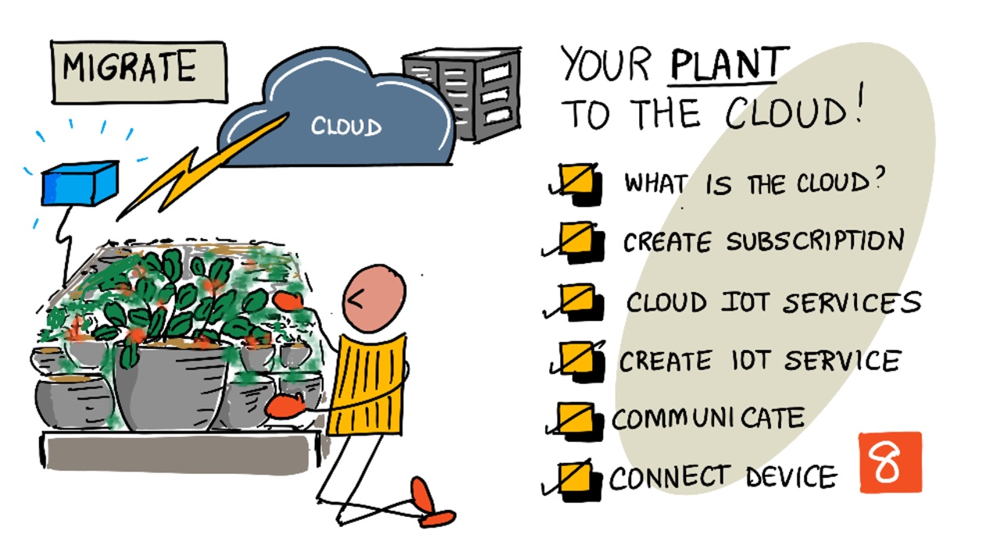
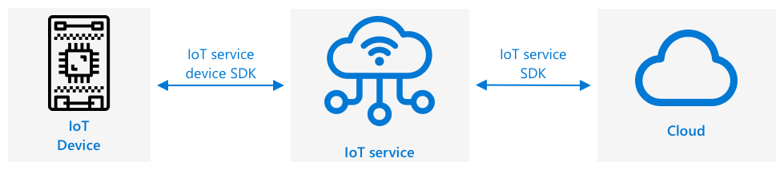
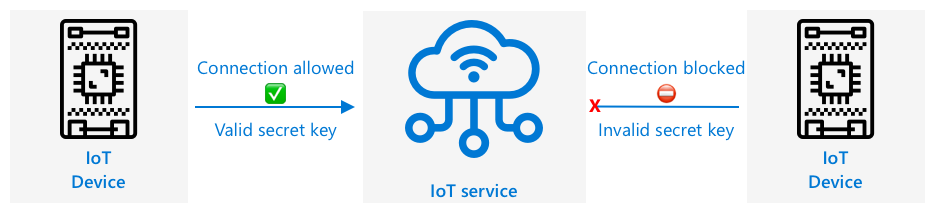

# Migrate your plant to the cloud



> Sketchnote by [Nitya Narasimhan](https://github.com/nitya). Click the image for a larger version.

## Introduction

In the last lesson, you learned how to connect your plant to an MQTT broker and controlled a relay from some server code running locally. This forms the core of the kind of internet-connected automated watering system that is used from individual plants at home up to commercial farms.

The IoT device communicated with a public MQTT broker as a way to demonstrate the principles, but this is not the most reliable or secure way. In this lesson you will learn about the cloud, and the capabilities of public cloud services for IoT. You will also build a small IoT service on [Cloudflare Workers](https://workers.cloudflare.com), a platform with a free plan that does not need a credit card, and migrate your plant to it from the public MQTT broker.

In this lesson we'll cover:

* [What is the cloud?](#what-is-the-cloud)
* [Create a cloud account](#create-a-cloud-account)
* [Cloud IoT services](#cloud-iot-services)
* [Create an IoT service in the cloud](#create-an-iot-service-in-the-cloud)
* [Communicate with your IoT service](#communicate-with-your-iot-service)
* [Connect your device to the IoT service](#connect-your-device-to-the-iot-service)

## What is the cloud?

Before the cloud, when a company wanted to provide services to their employees (such as databases or file storage), or to the public (such as websites), they would build and run a data center. This ranged from a room with a small number of computers, to a building with many computers. The company would manage everything, including:

* Buying computers
* Hardware maintenance
* Power and cooling
* Networking
* Security, including securing the building and securing the software on the computers
* Software installation and updates

This could be very expensive, require a wide range of skilled employees, and be very slow to change when needed. For example, if an online store needed to plan for a busy holiday season, they would need to plan months in advance to buy more hardware, configure it, install it and install the software to run their sales process. After the holiday season was over and sales dropped back down, they would be left with computers they've paid for sitting idle till the next busy season.

✅ Do you think this would allow companies to move quickly? If an online clothing retailer suddenly got popular due to a celebrity being seen in their clothes, would they be able to increase their computing power quickly enough to support the sudden influx of orders?

### Someone else's computer

The cloud is often jokingly referred to as 'someone else's computer'. The initial idea was simple - instead of buying computers, you rent someone else's computer. Someone else, a cloud computing provider, would manage huge data centers. They would be responsible for buying and installing the hardware, managing power and cooling, networking, building security, hardware and software updates, everything. As a customer, you would rent the computers you need, renting more as demand spikes, then reducing the number you rent if demand drops. These cloud data centers are all around the world.

These data centers can be multiple square kilometers in size, and they require such large amounts of power that some have their own power stations.

> 💁 Because of their size and the level of investment from the cloud providers, they are usually very environmentally friendly. They are more efficient than huge numbers of small data centers, they run mostly on renewable energy, and cloud providers work hard to reduce waste, cut water usage, and replant forests to make up for those cut down to provide space to build data centers. Most providers publish sustainability reports where you can read more about their work.

✅ Do some research: Read up on the major clouds such as [AWS from Amazon](https://aws.amazon.com), [GCP from Google](https://cloud.google.com) and [Cloudflare](https://www.cloudflare.com). How many data centers do they have, and where are they in the world?

Using the cloud keeps costs down for companies, and allows them to focus on what they do best, leaving the cloud computing expertise in the hands of the provider. Companies no longer need to rent or buy data center space, pay different providers for connectivity and power, or employ experts. Instead, they can pay one monthly bill to the cloud provider to have everything taken care off.

The cloud provider can then use economies of scale to drive costs down, buying computers in bulk at lower costs, investing in tooling to reduce their workload for maintenance, even designing and building their own hardware to improve their cloud offering.

### Cloudflare

Cloudflare runs a global network of data centers in hundreds of cities around the world, and is the cloud you will be using for these lessons. Instead of renting a computer, you give Cloudflare a small program, and it runs that program in the data center closest to the user. You will learn more about this way of running code in the next lesson.

## Create a cloud account

To use services in the cloud, you will need to sign up for an account with a cloud provider. For this lesson, you will be signing up for a Cloudflare account. If you already have a Cloudflare account you can skip this task. The details described here are correct at the time of writing, but may change.

You do not need a credit card, a school email address or a domain name. The free plan is more than enough for these lessons.

> 💁 At the time of writing, the free plan of Cloudflare Workers allows 100,000 requests a day, and the Workers KV storage you will use in this lesson allows 100,000 reads and 1,000 writes a day. Limits change over time, so check the [Cloudflare pricing pages](https://workers.cloudflare.com/pricing) before you start.

### Task - sign up for a free cloud account

1. Go to [dash.cloudflare.com/sign-up](https://dash.cloudflare.com/sign-up) and create an account with an email address and a password.

1. Confirm your email address when asked.

## Cloud IoT services

The public test MQTT broker you have been using is a great tool when learning, but has a number of drawbacks as a tool to use in a commercial setting:

* Reliability - it's a free service with no guarantees, and can be turned off at any time
* Security - it is public, so anyone could listen to your telemetry or send commands to control your hardware
* Performance - it is designed for only a few test messages, so wouldn't cope with a large amount of messages being sent
* Discovery - there is no way to know what devices are connected

IoT services in the cloud solve these problems. They are maintained by large cloud providers who invest heavily in reliability and are on hand to fix any issues that might arise. They have security baked-in to stop hackers reading your data or sending rogue commands. They are also high performance, being able to handle many millions of messages every day, taking advantage of the cloud to scale as needed.

> 💁 Although you pay for these upsides with a monthly fee when you use them at scale, cloud platforms have free plans with a limited amount of requests per day. This is usually more than enough for a developer to learn about the service. In this lesson you will build a small IoT service of your own using the free plan.

IoT devices connect to a cloud service either using a device SDK (a library that provides code to work with the features of the service), or directly via a communication protocol such as MQTT or HTTP. A device SDK is usually the easiest route to take as it handles everything for you, such as knowing what topics to publish or subscribe to, and how to handle security. In this lesson your device will use the second route, sending plain HTTPS requests to your service.



Your device then communicates with other parts of your application over this service - similar to how you sent telemetry and received commands over MQTT. Messages come from your device to the service where other components of your application can then read them, and messages can then be sent back to your device.



These services implement security by knowing about all the devices that can connect and send data, either by having the devices pre-registered with the service, or by giving the devices secret keys or certificates they can use to register themselves with the service the first time they connect. Unknown devices are unable to connect, if they try the service rejects the connection and ignores messages sent by them.

✅ Do some research: What is the downside of having an open IoT service where any device or code can connect? Can you find specific examples of hackers taking advantage of this?

Other components of your application can connect to the IoT service and learn about all the devices that are connected or registered, and communicate with them directly in bulk or individually.

> 💁 IoT services also implement additional capabilities, and the cloud providers have additional services and applications that can be connected to the service. For example, if you want to store all the telemetry messages sent by all the devices in a database, it's usually only a few clicks in the cloud provider's configuration tool to connect the service to a database and stream the data in.

## Create an IoT service in the cloud

Now that you have a cloud account, you can create an IoT service. Your service will be a small program running on Cloudflare Workers, with a Workers KV store to remember which devices are registered and which commands are waiting for them. It will do three things:

* Only accept telemetry from registered devices that know their secret key.
* Show the telemetry it receives, so you can monitor your devices.

The cloud services available in Cloudflare can be configured through a web-based dashboard, or via a command-line tool called *Wrangler*. For this task, you will use Wrangler.

### Task - install the tools and log in

1. Since *Wrangler* runs on Node.js, make sure Node.js is installed. If it isn't, you can download and install it from [Node.js](https://nodejs.org).

    ```sh
    node --version
    ```

1. Log in to your Cloudflare account from the command line:

    ```sh
    npx wrangler login
    ```

    A web page will be launched in your default browser. Log in using the account you created, allow access, and then close the browser tab.

1. Check that you are logged in:

    ```sh
    npx wrangler whoami
    ```

    You will see the name of your account.

1. Create a new Workers project, which will be called `soil-moisture-iot`:

    ```sh
    npm create cloudflare@latest soil-moisture-iot
    ```

	If prompted, install the required packages. When asked, choose the **Hello World** starter, the **Worker only** type and **JavaScript** language. You do **not** need to add ai agents, do **not** need to use Git, and you do **not** need to deploy it yet.

1. Open the newly created folder in a terminal. All the following steps assume that you are working inside the Workers project directory:

    ```sh
    cd soil-moisture-iot
    ```

### Task - create a storage for your device

Cloudflare services, such as Workers or KV storage, are referred to as **resources**. Workers KV is a key-value store, a simple database where you save a value under a name. Your service will use one to keep a list of registered devices, and the commands waiting for them.

1. Create the storage:

    ```sh
    npx wrangler kv namespace create DEVICE_STATE
    ```

    The output shows the `id` of the new storage.
    
    Newer versions of Wrangler may offer to add this configuration for you. If prompted, select **yes**, keep the binding name **DEVICE_STATE** and select **no** when asked whether to connect to a remote resource. Once this configuration is complete, you can skip the next step.

1. Connect the storage to your Worker. If the storage was not added automatically, open `wrangler.jsonc` and add the storage, replacing `<namespace id>` with the id from the output:

    ```jsonc
    "kv_namespaces": [
      { "binding": "DEVICE_STATE", "id": "<namespace id>" }
    ]
    ```

    This makes the storage available to your code as `env.DEVICE_STATE`.

### Task - write the IoT service

1. Replace the contents of `src/index.js` with the following code:

    ```javascript
    export default {
      async fetch(request, env) {
        const url = new URL(request.url);

        if (request.method === "POST" && url.pathname === "/telemetry") {
          return handleTelemetry(request, env);
        }
        return new Response("Not found", { status: 404 });
      },
    };

    // A device sends telemetry and the service confirms that it was received
    async function handleTelemetry(request, env) {
      const deviceId = request.headers.get("x-device-id");
      const deviceKey = request.headers.get("x-api-key");
      if (!deviceId || !deviceKey) {
        return new Response("Unauthorized", { status: 401 });
      }

      // Only registered devices with the right secret key are accepted
      const registeredKey = await env.DEVICE_STATE.get(`device:${deviceId}`);
      if (registeredKey === null || registeredKey !== deviceKey) {
        return new Response("Unauthorized", { status: 401 });
      }

      let telemetry;
      try {
        telemetry = await request.json();
      } catch {
        return new Response("Invalid JSON", { status: 400 });
      }

      console.log(JSON.stringify({ device: deviceId, telemetry }));

      return Response.json({ status: "received" });
    }
    ```

    The service has one address, `/telemetry`, used by your devices. It checks that the device is registered and knows its secret key, reads the telemetry, writes it to the log, and replies with a confirmation that it was received.

    > 💁 The code checks every request, so that nobody who finds the address of your service can send data as one of your devices.

### Task - deploy your IoT service

1. Deploy the service to cloudflare:

    ```sh
    npx wrangler deploy
    ```

    The first time, Wrangler may ask you to choose a `workers.dev` `<subdomain>` for your account. The `<subdomain>` must be unique, so choose a name based on your name or student number. At the end of the output you will see the address of your service, which looks like:

    ```output
    https://soil-moisture-iot.<your-subdomain>.workers.dev
    ```

    Take a note of this address.

## Communicate with your IoT service

In the previous lesson, you used MQTT and sent messages back and forward on different topics, with the different topics having different purposes. IoT services have a number of defined ways for the device to communicate with the service, or for the service to communicate with the device. In your service these are:

* Device to cloud (D2C) messages - these are messages sent from a device to the service, such as telemetry. They can then be read by your application code, for example from the log.
* Device identity - the service knows which devices are registered, and each one has its own secret key, so you can allow or block devices one by one.

Messages in the other direction, from the cloud to the device, such as a command to control an actuator, are called cloud to device (C2D) messages. Your service doesn't send any yet. In the next lesson you will add code that decides when to water the plant, and the service will send the command back in the reply to the telemetry.

The device always starts the communication. It sends its telemetry in a request, and the service replies. This means the device only makes outgoing connections, so it works behind a home router without any configuration.

> 💁 Workers KV is designed for data that is read often and written rarely. Your service reads from it on every telemetry request, to check the device, and you write to it only when you register a device.

✅ Do some research: Read more about the different ways IoT platforms exchange messages with devices, such as telemetry, commands, and device state or settings. Which ones does your service not support?

## Connect your device to the IoT service

Once the service is deployed, your IoT device can connect to it. Only registered devices can connect to a service, so you will need to register your device first. When you register it, you create a secret key that the device uses to prove who it is. The device needs the address of the service, its ID and its key.

> 🎓 A secret key is a piece of text that only your device and the service know. It is sent with every request to prove that the request comes from your device.

> ⚠️ Secret keys should be kept secure! Security will be covered in more detail in a future lesson.

### Task - register your IoT device

1. Generate a secret key for your device:

    ```sh
    node -e "console.log(require('crypto').randomBytes(24).toString('hex'))"
    ```

    Take a note of the output, as you will need it later.

1. Register the device in the storage of your service, replacing `<device key>` with the key you just generated. Run this from the project folder:

    ```sh
    npx wrangler kv key put --binding=DEVICE_STATE --remote \
        "device:soil-moisture-sensor" "<device key>"
    ```

    This registers a device with an ID of `soil-moisture-sensor`.

    > 💁 The `--remote` option is important. Without it, the key is saved in a local test storage and not in the storage of your deployed service.

1. Test that your service accepts the device, by sending a telemetry message with `curl`:

    ```sh
    curl -X POST https://soil-moisture-iot.<your-subdomain>.workers.dev/telemetry \
         -H "Content-Type: application/json" \
         -H "x-device-id: soil-moisture-sensor" \
         -H "x-api-key: <device key>" \
         -d '{"soil_moisture": 3342}'
    ```

	Replace `<your-subdomain>` with the name you used for your subdomain and `<device key>` with the value generated for your device key.

    You should see:

    ```output
    {"status":"received"}
    ```

    Try again with a wrong key, and check that you get `Unauthorized`.

### Task - connect your IoT device to the cloud

Your device needs to send a request like the one you just tested with `curl`. This is the information it needs:

| | |
|---|---|
| Address | `https://soil-moisture-iot.<your-subdomain>.workers.dev/telemetry` |
| Method | `POST` |
| Headers | `Content-Type: application/json`, `x-device-id: soil-moisture-sensor`, `x-api-key: <device key>` |
| Body | `{"soil_moisture": 3342}` |
| Reply | `{"status": "received"}` |
| Errors | `401` for an unknown device or a wrong key, `400` for invalid JSON |

The device does not need to do anything with the reply for now.

Work through the relevant guide to connect your IoT device to the cloud:

- **[Microcontroller ESP32](./esp32-connect-cloud.md) <<<<----------**

### Task - monitor events

For now, you won't be updating your server code. Instead you can use Wrangler to monitor events from your IoT device.

1. Make sure your IoT device is running and sending soil moisture telemetry values.

1. Run the following command in the terminal to monitor the log of your service:

    ```sh
    npx wrangler tail
    ```

    You will see messages appear in the console output as they are sent by your IoT device.

    ```output
    POST https://soil-moisture-iot.<your-subdomain>.workers.dev/telemetry - Ok
      (log) {"device":"soil-moisture-sensor","telemetry":{"soil_moisture":3342}}
    POST https://soil-moisture-iot.<your-subdomain>.workers.dev/telemetry - Ok
      (log) {"device":"soil-moisture-sensor","telemetry":{"soil_moisture":3134}}
    ```

    The content of `telemetry` will match the message sent by your IoT device.

    > 💁 The exact format of the output may differ between versions of Wrangler.

1. Exit the monitor with `Ctrl+C` when you are done.

---

## 🚀 Challenge

The free plan of Cloudflare Workers allows 100,000 requests a day, and the Workers KV store allows 100,000 reads a day. The code you wrote sends telemetry messages every 10 seconds, and your service reads from the store once for every message, to check the device. How many messages a day is one message every 10 seconds, and how many reads is that?

Think about how often soil moisture measurements should be sent? How can you change your code to stay within the free plan and check as often as needed but not too often? What if you wanted to add a second device?

## Assignment

[Learn about cloud services](./assignment.md)
