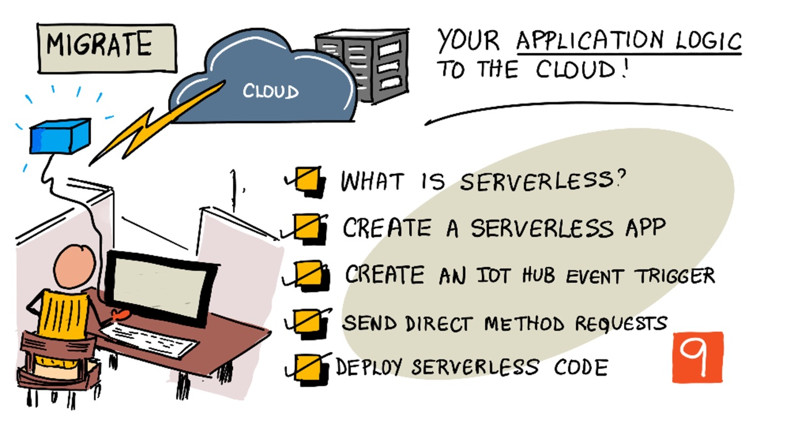
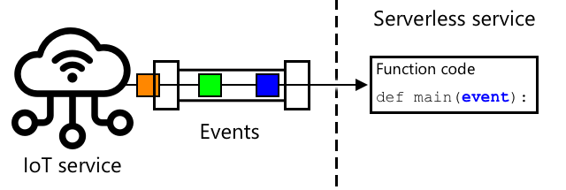

# Migrate your application logic to the cloud



> Sketchnote by [Nitya Narasimhan](https://github.com/nitya). Click the image for a larger version.

## Introduction

In the last lesson, you built an IoT service on Cloudflare Workers, registered your plant as a device, and used it to receive and monitor telemetry. However, the code that decides when to water the plant still runs on your own computer. If the computer is switched off, nothing happens.

In this lesson you will learn what *serverless* code is, and move the watering logic into your IoT service, so that it runs in the cloud without any server on your side. Your device will send its soil moisture, the service will decide if the plant needs watering, and the reply will carry the command for the relay.

In this lesson we'll cover:

* [What is serverless?](#what-is-serverless)
* [Create a serverless application](#create-a-serverless-application)
* [Deploy your serverless code](#deploy-your-serverless-code)
* [HTTP trigger](#http-trigger)
* [Send commands back to your device](#send-commands-back-to-your-device)

## What is serverless?

Serverless, also called *Functions as a Service* (FaaS), is a way of running code in the cloud where you write only a small piece of code, called a *function*, and the cloud provider takes care of everything else: the servers, the operating system, the scaling and the updates. Your function sits idle until something happens, such as a web request, a message or a timer. When that *event* arrives, the provider starts your code, runs it, and stops it again.



The IoT service you created in the last lesson is already serverless: it only runs when a request arrives from your device or from you. You can compare this with the server code you ran in the earlier lessons, which had to be running all the time on a computer, waiting for telemetry.

The main advantages are:

1. **No servers to manage** - you don't install, patch or monitor a machine.
2. **Scale** - if a thousand devices send telemetry at the same time, the provider starts as many copies of your function as needed. If there is no telemetry, nothing runs.
3. **You pay for what you use** - providers charge per execution rather than for a server that sits idle, and most offer a free plan that is more than enough for learning.

There are also limits that you need to design around:

* Functions are **short lived**. They have a limit on how long they can run, so a function cannot wait for 20 seconds and then do something else.
* Functions are **stateless**. Nothing is remembered between two runs, unless you store it somewhere else, such as the store you created in the last lesson.

✅ Do some research: What are other examples where serverless is a good fit, and where would a server that runs all the time be better?

### Cloudflare Workers

Many cloud providers have a serverless service, for example AWS Lambda, Google Cloud Functions and Cloudflare Workers. In this lesson you will keep using Cloudflare Workers, which runs your code in Cloudflare's data centers around the world, close to the user.

| | Cloudflare Workers |
|---|---|
| Trigger | HTTP request, timer (Cron Trigger) and more |
| Language | JavaScript / TypeScript (and Python in beta) |
| Storage | Workers KV and others |
| Deploy | `wrangler deploy` |

> 💁 At the time of writing, the free plan of Cloudflare Workers allows 100,000 requests a day, with 10 milliseconds of CPU time for each request. Limits change over time, so check the [Cloudflare Workers pricing page](https://workers.cloudflare.com/pricing) before you start.

## Create a serverless application

You already have everything you need: a Cloudflare account, the tools installed, and the `soil-moisture-iot` project from the last lesson. In this lesson you will add the watering logic to that project.

### Task - open your project

1. Open the `soil-moisture-iot` folder in a terminal, and check that you are still logged in to Cloudflare:

    ```sh
    cd soil-moisture-iot
    npx wrangler whoami
    ```

    If you are not logged in, run `npx wrangler login` again.

### Task - write the function

The service you wrote in the last lesson accepts telemetry from registered devices. You will now change it so that the reply contains a decision based on the soil moisture. This is the same logic as the server code you wrote before.

1. Open `src/index.js` and add the following line at the beginning of the file to define the watering threshold:

    ```javascript
    const THRESHOLD = 2047;
    ```

    > 💁 Whether a high value means dry or wet soil depends on your sensor. Use the same comparison you used in the earlier lessons.

1. Replace the `handleTelemetry` function with the following code:

    ```javascript
    // A device sends telemetry and receives a command in the reply
    async function handleTelemetry(request, env) {
      const deviceId = request.headers.get("x-device-id");
      const deviceKey = request.headers.get("x-api-key");
      if (!deviceId || !deviceKey) {
        return new Response("Unauthorized", { status: 401 });
      }

      // Only registered devices with the right secret key are accepted
      const registeredKey = await env.DEVICE_STATE.get(`device:${deviceId}`);
      if (registeredKey === null || registeredKey !== deviceKey) {
        return new Response("Unauthorized", { status: 401 });
      }

      let telemetry;
      try {
        telemetry = await request.json();
      } catch {
        return new Response("Invalid JSON", { status: 400 });
      }

      const soilMoisture = telemetry.soil_moisture;
      if (typeof soilMoisture !== "number") {
        return new Response("soil_moisture must be a number", { status: 400 });
      }

      // Decide if the plant needs watering
      const command = soilMoisture > THRESHOLD ? "relay_on" : "relay_off";

      console.log(JSON.stringify({ device: deviceId, soil_moisture: soilMoisture, command }));

      return Response.json({ command });
    }
    ```

    The function checks the device, reads the soil moisture and validates it. Then it decides by itself: if the soil moisture is above the threshold it answers `relay_on`, otherwise `relay_off`.

    Leave the rest of the file as it was.
    
> 💁 You can find this code in the [code/worker](code/worker) folder.

### Task - test the function on your computer

You can run the service on your computer to test it before you deploy it. The test uses a local copy of the storage, separate from the one in the cloud.

1. Register a test device in the local storage. Without the `--remote` option, this command writes to the local storage:

    ```sh
    npx wrangler kv key put --binding=DEVICE_STATE "device:test-device" "my-test-key"
    ```

1. Start the service on your computer:

    ```sh
    npx wrangler dev
    ```

    The service is now running locally at `http://localhost:8787`.

1. From a second terminal, send some telemetry:

    ```sh
    curl -X POST http://localhost:8787/telemetry \
         -H "Content-Type: application/json" \
         -H "x-device-id: test-device" \
         -H "x-api-key: my-test-key" \
         -d '{"soil_moisture": 3020}'
    ```

    You should see:

    ```output
    {"command":"relay_on"}
    ```

    Try a value below the threshold, and a request with a wrong key, and check the answers.

1. Press `x` in the terminal to stop the local service.

## Deploy your serverless code

At the moment your new code only runs on your computer. Now you will deploy it so that it runs on Cloudflare's network, replacing the version from the last lesson.

### Task - deploy your function

1. Deploy the service from the project folder:

    ```sh
    npx wrangler deploy
    ```

    The address of your service is the same as in the last lesson:

    ```output
    https://soil-moisture-iot.<your-subdomain>.workers.dev
    ```

    The device you registered in the last lesson is kept in the cloud, so you do not need to register it again.

1. Test the deployed service with `curl`, using the key of your device from the last lesson:

    ```sh
    curl -X POST https://soil-moisture-iot.<your-subdomain>.workers.dev/telemetry \
         -H "Content-Type: application/json" \
         -H "x-device-id: soil-moisture-sensor" \
         -H "x-api-key: <device key>" \
         -d '{"soil_moisture": 3020}'
    ```

1. If necessary, update the `service_url`, `service_url` and `service_url` values in your ESP32 code, then run it. Your plant is now controlled by code running in the cloud, so you no longer need to keep running the service on your computer.

## HTTP trigger

A function only runs when something triggers it. A Cloudflare Worker is triggered by an **HTTP request**. In your service, the `/telemetry` address is the trigger: your device sends its telemetry as a web request, the function runs, and it answers with a command.

The device sends the telemetry directly to the function over HTTPS. The function runs when the request arrives, makes its decision, and the reply carries the command that the device has to run.

> 💁 Workers can also be triggered by a timer, called a *Cron Trigger*. This is useful for tasks that need to happen on a schedule, such as checking if devices have stopped sending telemetry.

## Send commands back to your device

The function does not need a permanent connection to your device. The command travels **in the reply** to the telemetry request, and the device decides what to do with it.

This design has some consequences:

- The device always starts the communication. It only makes outgoing connections, so it works behind a home router or a firewall without any configuration.
- The cloud can only deliver a command when the device sends a request.

✅ Think about the consequences. If the soil dries out just after the device has sent its telemetry, when would the plant be watered? How could you reduce this delay?


### Task - handle commands on your device

The service now answers every telemetry message with a command, `relay_on` or `relay_off`. Work through the relevant guide to make your device act on it:

- **[Microcontroller ESP32](esp32-handle-commands.md) <<<<----------**

### Task - monitor your function

1. Watch the log of the deployed service, while your device is sending telemetry:

    ```sh
    npx wrangler tail
    ```

    You will see each request, including the line written by your code, with the soil moisture and the command.

1. You can also see the number of requests in the Cloudflare dashboard, under *Workers & Pages*.

> ⚠️ Keep your device key secret. Anyone who has it can send telemetry as your device, and so decide when your plant is watered. If you share your code, remove the key first, and if it is exposed, register the device again with a new key and update your device.

> 🗑 When you finish all the lessons of this project, you can remove the service with `npx wrangler delete`, and the store with `npx wrangler kv namespace delete --namespace-id <namespace id>`.

---

## 🚀 Challenge

The free plan of Cloudflare Workers allows 100,000 requests a day. Your device sends one request every 10 seconds, and waits 20 seconds more when it waters the plant. How many requests a day is this for one device? Each request also reads the store once, to check the device, and the store allows 100,000 reads a day. How many devices can share one account before they reach the limit?

Think about how often soil moisture should be measured, and how you could change your code to stay well within the limits. How could you change the threshold without deploying the code again? What would you have to change if you wanted the function to remember when the plant was last watered, so that it doesn't water it again too soon, bearing in mind that the store only allows 1,000 writes a day?

## Review & Self Study

* Read the [Cloudflare Workers documentation](https://developers.cloudflare.com/workers/) about how Workers run and about secrets.
* Read about the limits of serverless in the [Cloudflare Workers limits page](https://developers.cloudflare.com/workers/platform/limits/).
* Read about other serverless platforms, such as [AWS Lambda](https://aws.amazon.com/lambda/) and [Google Cloud Functions](https://cloud.google.com/functions), and compare how a function is triggered in each of them.