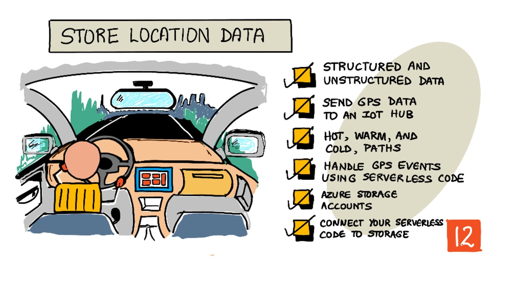
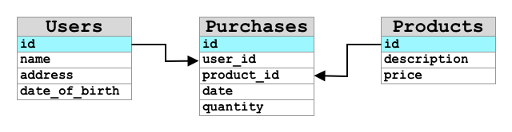
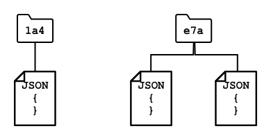

# Store location data



> Sketchnote by [Nitya Narasimhan](https://github.com/nitya). Click the image for a larger version.

## Introduction

In the last lesson, you learned how to use a GPS sensor to capture location data. To use this data to visualize the location of a truck laden with food, and it's journey, it needs to be sent to an IoT service in the cloud, and then stored somewhere.

In this lesson you will learn about the different ways to store IoT data, and learn how to store data from your IoT service using serverless code.

In this lesson we'll cover:

* [Structured and unstructured data](#structured-and-unstructured-data)
* [Send GPS data to an IoT service](#send-gps-data-to-an-iot-service)
* [Hot, warm, and cold paths](#hot-warm-and-cold-paths)
* [Handle GPS events using serverless code](#handle-gps-events-using-serverless-code)
* [Cloud storage options](#cloud-storage-options)
* [Connect your serverless code to storage](#connect-your-serverless-code-to-storage)

## Structured and unstructured data

Computer systems deal with data, and this data comes in all manner of different shapes and sizes. It can vary from single numbers, to large amounts of text, to videos and images, and to IoT data. Data can usually be divided into one of two categories - *structured* data and *unstructured* data.

* **Structured data** is data with a well-defined, rigid structure that doesn't change and usually maps to tables of data with relationships. One example is a persons details including their name, date of birth and address.
* **Unstructured data** is data without a well-defined, rigid structure, including data that can change structure frequently. One example is documents such as written documents or spreadsheets.

✅ Do some research: Can you think of some other examples of structured and unstructured data?

> 💁 There is also semi-structured data that is structured but doesn't fit into fixed tables of data

IoT data is usually considered to be unstructured data.

Imagine you were adding IoT devices to a fleet of vehicles for a large commercial farm. You might want to use different devices for different types of vehicle. For example:

* For farm vehicles like tractors you want GPS data to ensure they are working on the correct fields
* For delivery trucks transporting food to warehouses you want GPS data as well as speed and acceleration data to ensure the driver is driving safely, and drive identity and start/stop data to ensure drive compliance with local laws on working hours
* For refrigerated trucks you also want temperature data to ensure the food doesn't get too hot or cold and spoil in transit

This data can change constantly. For example, if the IoT device is in a truck cab, then the data it sends may change as the trailer changes, for example only sending temperature data when a refrigerated trailer is used.

✅ What other IoT data might be captured? Think about the kinds of loads trucks can carry, as well as maintenance data.

This data varies from vehicle to vehicle, but it all gets sent to the same IoT service for processing. The IoT service needs to be able to process this unstructured data, storing it in a way that allows it to be searched or analyzed, but works with different structures to this data.

### SQL vs NoSQL storage

Databases are services that allow you to store and query data. Database come in two types - SQL and NoSQL

#### SQL databases

The first databases were Relational Database Management Systems (RDBMS), or relational database. These are also known as SQL databases after the Structured Query Language (SQL) used to interact with them to add, remove, update or query data. These database consist of a schema - a well-defined set of tables of data, similar to a spreadsheet. Each table has multiple named columns. When you insert data, you add a row to the table, putting values into each of the columns. This keeps the data in a very rigid structure - although you can leave columns empty, if you want to add a new column you have to do this on the database, populating values for the existing rows. These databases are relational - in that one table can have a relationship to another.



For example, if you stored a users personal details in a table, you would have some kind of internal unique ID per user that is used in a row in a table that contains the users name and address. If you then wanted to store other details about that user, such as their purchases, in another table, you would have one column in the new table for that users ID. When you look up a user, you can use their ID to get their personal details from one table, and their purchases from another.

SQL databases are ideal for storing structured data, and for when you want to ensure the data matches your schema.

✅ If you haven't used SQL before, take a moment to read up on it on the [SQL page on Wikipedia](https://wikipedia.org/wiki/SQL).

Some well known SQL databases are MySQL, PostgreSQL and SQLite.

✅ Do some research: Read up on some of these SQL databases and their capabilities.

#### NoSQL database

NoSQL databases are called NoSQL because they don't have the same rigid structure of SQL databases. They are also known as document databases as they can store unstructured data such as documents.

> 💁 Despite their name, some NoSQL databases allow you to use SQL to query the data.



NoSQL database do not have a pre-defined schema that limits how data is stored, instead you can insert any unstructured data, usually using JSON documents. These documents can be organized into folders, similar to files on your computer. Each document can have different fields from other documents - for example if you were storing IoT data from your farm vehicles, some may have fields for accelerometer and speed data, others may have fields for the temperature in the trailer. If you were to add a new truck type, such as one with built in scales to track the weight of produce carried, then your IoT device could add this new field and it could be stored without any changes to the database.

Some well known NoSQL databases include MongoDB, CouchDB and key-value stores such as Redis.

✅ Do some research: Read up on some of these NoSQL databases and their capabilities.

In this lesson, you will be using NoSQL storage to store IoT data.

## Send GPS data to an IoT service

In the last lesson you captured GPS data from a GPS sensor connected to your IoT device. To store this IoT data in the cloud, you need to send it to an IoT service. Once again, you will be using the kind of IoT service you built in the previous project: a serverless service on Cloudflare Workers, with a Workers KV storage that keeps the list of registered devices.

<!---->

### Task - Create and deploy an IoT service and register an IoT device

1. Create a new IoT service with its own Worker project and device storage, then deploy it.

    > ⚠️ You can refer to the [instructions for creating an IoT service from project 2, lesson 8](../../../2-farm/lessons/8-migrate-your-plant-to-the-cloud/README.md#create-an-iot-service-in-the-cloud) if needed.

    Name the new project `gps-sensor-iot` and the device storage binding `DEVICE_STATE`, , as in lesson 8. Reuse the IoT service code from Lesson 8 and deploy it to Cloudflare.

1. Register a new device to the IoT service. Call this device `gps-sensor`, and take a note of the secret key you create for the device.

    > ⚠️ You can refer to the [instructions for registering a device from project 2, lesson 8](../../../2-farm/lessons/8-migrate-your-plant-to-the-cloud/README.md#task---register-your-iot-device) if needed.

### Task - send GPS data to an IoT service

Work through the relevant steps to send the GPS data to the IoT service. The device sends the same kind of request as in the previous project, but the body contains the GPS reading:

| | |
|---|---|
| Address | `https://gps-sensor-iot.<your-subdomain>.workers.dev/telemetry` |
| Method | `POST` |
| Headers | `Content-Type: application/json`, `x-device-id: gps-sensor`, `x-api-key: <device key>` |
| Body | `{"gps": {"lat": 39.81556, "lon": -7.48182}}` |

- **[Microcontroller ESP32](esp32-connect-cloud.md) <<<<----------**

### Task - monitor events

1. Run your device code and ensure messages are flowing into your IoT service using Wrangler to monitor the log of the service:

    ```sh
    npx wrangler tail
    ```

    Run this command from the `gps-sensor-iot` project folder. You will see the GPS telemetry appear in the console output as it is sent by your IoT device.

    ```output
    POST https://gps-sensor-iot.<your-subdomain>.workers.dev/telemetry - Ok
      (log) {"device":"gps-sensor","telemetry":{"gps":{"lat":39.81556,"lon":-7.48182}}}
    ```

## Hot, warm, and cold paths

Data that flows from an IoT device to the cloud is not always processed in real time. Some data needs real time processing, other data can be processed a short time later, and other data can be processed much later. The flow of data to different services that process the data at different times is referred to hot, warm and cold paths.

### Hot path

The hot path refers to data that needs to be processed in real time or near real time. You would use hot path data for alerts, such as getting alerts that a vehicle is approaching a depot, or that the temperature in a refrigerated truck is too high.

To use hot path data, your code would respond to events as soon as they are received by your cloud services.

### Warm path

The warm path refers to data that can be processed a short while after being received, for example for reporting or short term analytics. You would use warm path data for daily reports on vehicle mileage, using data gathered the previous day.

Warm path data is stored once it is received by the cloud service inside some kind of storage that can be quickly accessed.

### Cold path

The cold path refers to historic data, storing data for the long term to be processed whenever needed. For example, you could use the cold path to get annual mileage reports for vehicles, or run analytics on routes to find the most optimal route to reduce fuel costs.

Cold path data is stored in data warehouses - databases designed for storing large amounts of data that will never change and can be queried quickly and easily. You would normally have a regular job in your cloud application that would run at a regular time each day, week, or month to move data from warm path storage into the data warehouse.

✅ Think about the data you have captured so far in these lessons. Is it hot, warm or cold path data?

## Handle GPS events using serverless code

Once data is flowing into your IoT service, the serverless code of the service runs for every GPS message that arrives. This is the warm path - this data will be stored and used in the next lesson for reporting on the journey.

<!---->

### Task - handle GPS events using serverless code

1. Open the `gps-sensor-iot` project in VS Code and in a terminal.

    > ⚠️ You can refer to the [instructions for working with a serverless project from project 2, lesson 9](../../../2-farm/lessons/9-migrate-application-to-the-cloud/README.md#create-a-serverless-application) if needed.

1. From the `gps-sensor-iot` project folder, open `src/index.js` file in a text editor and update the `handleTelemetry` function so that the service processes the GPS telemetry. Replace the last two statements of the function, the `console.log` and the `return`, with the following:

    ```javascript
    const gps = telemetry.gps;
    if (!gps || typeof gps.lat !== "number" || typeof gps.lon !== "number") {
        return new Response("gps.lat and gps.lon must be numbers", { status: 400 });
    }

    console.log("Worker processed an event: " + JSON.stringify({ gps }));

    return Response.json({ status: "received" });
    ```

    The telemetry from your device is received by the service in the request, which is the trigger of the function. The code makes sure it contains a GPS location, writes it to the log, and confirms that it was received.
    
### Task - test the function on your computer

You can run the service on your computer to test it before you deploy it. Unlike the deployed service, it uses a simulated storage on your computer.
    
1. Register your device in the local storage. Without the `--remote` option, this command writes to the local storage:

    ```sh
    npx wrangler kv key put --binding=DEVICE_STATE "device:gps-sensor" "my-test-key"
    ```
1. Start the service on your computer.

    ```sh
    npx wrangler dev
    ```

	The service is now running locally at `http://localhost:8787`.

1. From a second terminal, send some telemetry:

    ```sh
    curl -X POST http://localhost:8787/telemetry \
         -H "Content-Type: application/json" \
         -H "x-device-id: gps-sensor" \
         -H "x-api-key: my-test-key" \
         -d '{"gps": {"lat": 39.81556, "lon": -7.48182}}'
    ```

    You should see:

    ```output
     Worker processed an event: {"gps": {"lat": 39.81556, "lon": -7.48182}}
    ```

    Try a request with a wrong key and verify that the service returns the expected responses.

1. Press `x` in the terminal to stop the local service.

## Cloud storage options

Cloudflare has several storage services that you can connect to your serverless code. You can store data as key-value pairs, as objects, in database tables, or in queues, and you can use more than one at the same time.

### Key-value storage

Workers KV is a key-value store. You save a value, such as a JSON document containing IoT data, under a name, called a *key*. Keys can contain forward slashes and a common prefix, so you can organize them like folders, and list all the keys that start with a prefix, similar to how files are stored on your computer hard disk. You create a store, called a *namespace*, and then connect it to your Worker.

You will use KV in this lesson to store IoT data.

> 💁 At the time of writing, the free plan of Workers KV allows 1 GB of data, 100,000 reads a day and 1,000 writes, deletes and lists a day. Limits change over time, so check the [Cloudflare Workers pricing page](https://developers.cloudflare.com/workers/platform/pricing/) before you start.

✅ Do some research: Read up on [Workers KV](https://developers.cloudflare.com/kv/)

### Object storage

R2 is object storage, for files and other large unstructured data such as images and movies. It is compatible with the interface of Amazon S3, so many existing tools can work with it. Data is stored in *buckets*, which can have folders to organize the objects.

> 💁 Check whether R2 needs a payment method on your account before using it with students, as this may differ from the other services in this lesson.

✅ Do some research: Read up on [Cloudflare R2](https://developers.cloudflare.com/r2/)

### Database storage

D1 is a serverless SQL database, based on SQLite. Unlike the other services in this lesson, it stores structured data in tables, with a schema that you define up front, and you query it using SQL.

✅ Do some research: Read up on [Cloudflare D1](https://developers.cloudflare.com/d1/)

### Queue storage

Queues allow you to store messages in a queue. You can add messages to the back of the queue, and a Worker can read them off the front, one after another or in batches. This allows messages to be stored while they wait to be processed. For example, if you wanted to run a regular job to process GPS data you could add it to a queue during the day, then process all the messages off the queue at night.

✅ Do some research: Read up on [Cloudflare Queues](https://developers.cloudflare.com/queues/)

## Connect your serverless code to storage

Your service now needs to connect to storage to store the messages from the device. A Worker connects to storage using a *binding*: a setting in the configuration of the Worker that gives your code a ready-to-use object, such as `env.GPS_DATA`.

In this part of the lesson, you will use a KV binding to see how to interact with storage.

<!---->

The data will be saved as a JSON document with the following format:

```json
{
    "device_id": <device_id>,
    "timestamp" : <time>,
    "gps" :
    {
        "lat" : <latitude>,
        "lon" : <longitude>
    }
}
```

### Task - connect your serverless code to a storage

01. Create a KV namespace for the GPS data:

    ```sh
    npx wrangler kv namespace create GPS_DATA
    ```

    The output shows the `id` of the new namespace.
    
    Newer versions of Wrangler may offer to add this configuration for you. If prompted, select **yes**, keep the binding name **GPS_DATA** and select **no** when asked whether to connect to a remote resource. Once this configuration is complete, you can skip the next step.

01. Connect the namespace to your Worker. Open `wrangler.jsonc` and add the namespace to the existing list of KV namespaces, replacing `<namespace id>` with the id from the output:

    ```jsonc
    "kv_namespaces": [
      { "binding": "DEVICE_STATE", "id": "<device store id>" },
      { "binding": "GPS_DATA", "id": "<namespace id>" }
    ]
    ```

    This makes the store available to your code as `env.GPS_DATA`.

01. In `src/index.js` file, inside the `handleTelemetry` function, add the following code immediately below the `console.log` statement:

    ```javascript
    const timestamp = new Date().toISOString();
    const key = `${deviceId}/${timestamp}-${crypto.randomUUID()}.json`;
    ```

    This code creates the time of the reading, and uses it with the device ID to create a key. Keys can be organized like folders, and device ID will be used for the folder name, so each device will have all its GPS events under one prefix. The key is this prefix, followed by a document name, separated with forward slashes, similar to Linux and macOS paths. The document name starts with the time, so that keys are listed in time order, followed by a unique ID generated using `crypto.randomUUID()`, with the file type of `json`.

    For example, for the `gps-sensor` device ID, the key might be `gps-sensor/2026-10-29T10:15:00.123Z-a9487ac2-b9cf-11eb-b5cd-1e00621e3648.json`.

01. Add the following code below the previous one:

    ```javascript
    const body = {
        device_id: deviceId,
        timestamp,
        gps,
    };
    ```

    This builds the body of the document that will be written to storage. It is a JSON document containing the device ID, the time the telemetry was received by the service, and the GPS coordinates from the telemetry.

    > 💁 The service uses the time it received the message. If your device stores readings while it is offline and sends them later, the device should send the time of each reading in the telemetry, and the service should use that time instead.

01. Add the following code below the previous one:

    ```javascript
    console.log(`Writing key ${key} - ${JSON.stringify(body)}`);
    await env.GPS_DATA.put(key, JSON.stringify(body));
    ```

    This code logs that a document is about to be written with its details, then writes the document body to the `GPS_DATA` storage under the new key.

01. Run the service locally using `npx wrangler dev` and then test it with the `curl` command used previously. You will see documents being written for all the GPS events in the output:

    ```output
    Worker processed an event: {"gps": {"lat": 39.81556, "lon": -7.48182}}
    Writing key gps-sensor/2026-10-29T10:15:00.123Z-4b6089fe-ba8d-11eb-bc7b-1e00621e3648.json - {"device_id":"gps-sensor","timestamp":"2026-10-29T10:15:00.123Z","gps":{"lat": 39.81556, "lon": -7.48182}}
    ```

    > 💁 While you use `npx wrangler dev`, the data is written to the simulated storage on your computer, not to the cloud.

> 💁 You can find this code in the [code/worker](code/worker) folder.

### Task - verify the stored data

To view the data created, you can use the *Storage & databases* section of the Cloudflare dashboard, where you can see the keys of a KV namespace, or the command line.

1. In the terminal run the following command to list the keys that start with the device ID:

    ```sh
    npx wrangler kv key list --binding=GPS_DATA --prefix "gps-sensor/"
    ```

    This will list out all the keys in the storage:

    ```output
    [
        { "name": "gps-sensor/2026-10-29T10:15:00.123Z-1810d55e-b9cf-11eb-9f5b-1e00621e3648.json" },
        { "name": "gps-sensor/2026-10-29T10:15:10.456Z-18293e46-b9cf-11eb-9f5b-1e00621e3648.json" },
        { "name": "gps-sensor/2026-10-29T10:15:20.789Z-1844549c-b9cf-11eb-9f5b-1e00621e3648.json" }
    ]
    ```

    > 💁 Without the `--remote` option, these commands show the simulated store you used with `npx wrangler dev`. Add `--remote` to see the store of your deployed service.

1. Read one of the documents using the following command:

    ```sh
    npx wrangler kv key get --binding=GPS_DATA "<key>"
    ```

    Replace `<key>` with the full filename shown in the previous step's output, including the prefix and the .json extension. To save the document to a local file, add `> <file_name>` at the end of the command.

    The document is a JSON file containing the GPS location details:

    ```json
    {"device_id":"gps-sensor","timestamp":"2026-10-29T10:15:00.123Z","gps":{"lat":39.81556,"lon":-7.48182}}
    ```

### Task - deploy your IoT service to the cloud

Now that your service is working, you can deploy it to the cloud.

1. Deploy your updated service from the project folder. The namespaces are connected through the configuration, so there is nothing else to create:

    ```sh
    npx wrangler deploy
    ```

1. The device you registered at the beginning of this lesson is already stored in the deployed service. Make sure that the IoT service configuration values in your device code are correct: `service_url`, `device_id`, and `device_key`. Then leave your device running for a while to collect enough GPS data for the next lesson.

1. You can use Wrangler to monitor the service logs and confirm that messages are being received by your IoT service:

    ```sh
    npx wrangler tail
    ```

1. You can also verify that the data is reaching the cloud by listing the keys stored in the deployed storage:

    ```sh
    npx wrangler kv key list --binding=GPS_DATA --prefix "gps-sensor/" --remote
    ```

---

## 🚀 Challenge

Every GPS reading you store is a write to the KV store, and the free plan allows 1,000 writes a day. How often can your device send a reading if it should be tracking a truck all day? What would you change if you needed more readings?

## Review & Self Study

* Read about structured data on the [Data model page on Wikipedia](https://wikipedia.org/wiki/Data_model)
* Read about semi-structured data on the [Semi-structured data page on Wikipedia](https://wikipedia.org/wiki/Semi-structured_data)
* Read about unstructured data on the [Unstructured data page on Wikipedia](https://wikipedia.org/wiki/Unstructured_data)
* Read more on Cloudflare storage and the different storage types in the [Workers KV](https://developers.cloudflare.com/kv/), [R2](https://developers.cloudflare.com/r2/) and [D1](https://developers.cloudflare.com/d1/) documentation
