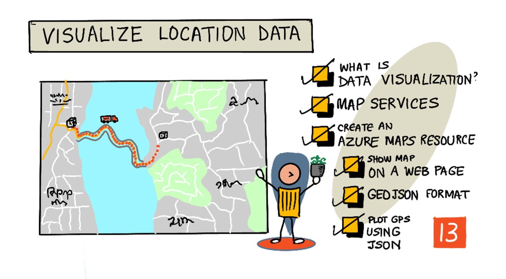
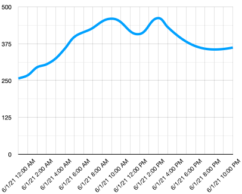
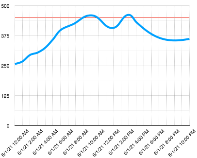
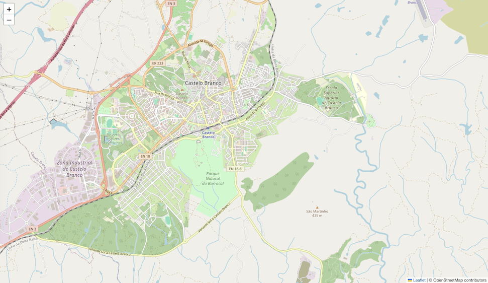
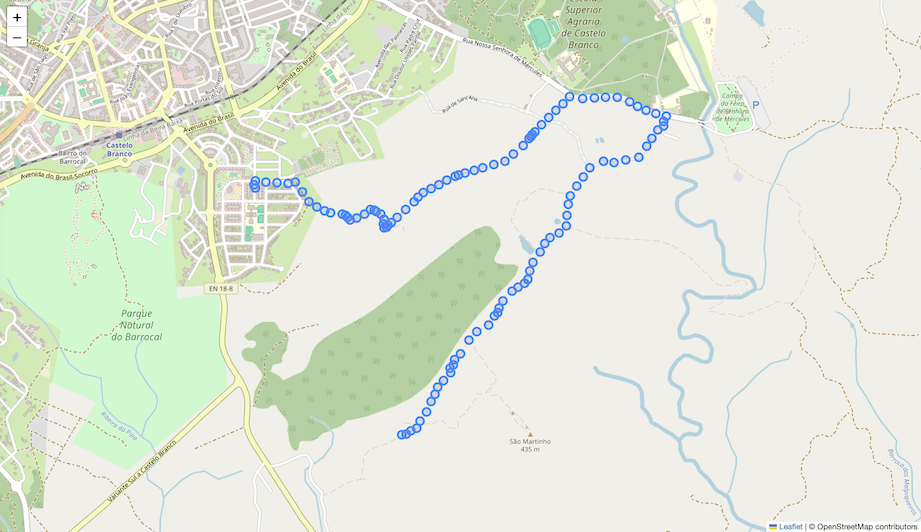

# Visualize location data



> Sketchnote by [Nitya Narasimhan](https://github.com/nitya). Click the image for a larger version.

## Introduction

In the last lesson you learned how to get GPS data from your sensors to save to the cloud in a storage namespace using serverless code. Now you will discover how to visualize those points on a map. You will learn how to create a map on a web page, learn about the GeoJSON data format and how to use it to plot all the captured GPS points on your map.

In this lesson we'll cover:

* [What is data visualization](#what-is-data-visualization)
* [Map services](#map-services)
* [Prepare to use OpenStreetMap](#prepare-to-use-openstreetmap)
* [Show a map on a web page](#show-a-map-on-a-web-page)
* [The GeoJSON format](#the-geojson-format)
* [Plot GPS data on a Map using GeoJSON](#plot-gps-data-on-a-map-using-geojson)

> 💁 This lesson will involve a small amount of HTML and JavaScript. If you would like to learn more about web development using HTML and JavaScript, check out [Web development for beginners](https://github.com/microsoft/Web-Dev-For-Beginners).

## What is data visualization

Data visualization, as the name suggests, is about visualizing data in ways that make it easier for humans to understand. It is usually associated with charts and graphs, but is any way of pictorially representing data to help humans to not only understand the data better, but help them make decisions.

Taking a simple example - back in the farm project you captured soil moisture settings. A table of soil moisture data captured every hour for the 1st June 2021 might be something like the following:

| Date             | Reading |
| ---------------- | ------- |
| 01/06/2021 00:00 | 257     |
| 01/06/2021 01:00 | 268     |
| 01/06/2021 02:00 | 295     |
| 01/06/2021 03:00 | 305     |
| 01/06/2021 04:00 | 325     |
| 01/06/2021 05:00 | 359     |
| 01/06/2021 06:00 | 398     |
| 01/06/2021 07:00 | 410     |
| 01/06/2021 08:00 | 429     |
| 01/06/2021 09:00 | 451     |
| 01/06/2021 10:00 | 460     |
| 01/06/2021 11:00 | 452     |
| 01/06/2021 12:00 | 420     |
| 01/06/2021 13:00 | 408     |
| 01/06/2021 14:00 | 431     |
| 01/06/2021 15:00 | 462     |
| 01/06/2021 16:00 | 432     |
| 01/06/2021 17:00 | 402     |
| 01/06/2021 18:00 | 387     |
| 01/06/2021 19:00 | 360     |
| 01/06/2021 20:00 | 358     |
| 01/06/2021 21:00 | 354     |
| 01/06/2021 22:00 | 356     |
| 01/06/2021 23:00 | 362     |

As a human, understanding that data can be hard. It's a wall of numbers without any meaning. As a first step to visualizing this data, it can be plotted on a line chart:



This can be further enhanced by adding a line to indicate when the automated watering system was turned on at a soil moisture reading of 450:



This chart shows very quickly not only what the soil moisture levels were, but the points where the watering system was turned on.

Charts are not the only tool to visualize data. IoT devices that track weather can have web apps or mobile apps that visualize weather conditions using symbols, such as a cloud symbol for cloudy days, a rain cloud for rainy days and so on. There are a huge number of ways to visualize data, many serious, some fun.

✅ Think about ways you've seen data visualized. Which methods have been the clearest and have allowed you to make decisions fastest?

The best visualizations allow humans to make decisions quickly. For example, having a wall of gauges showing all manner of readings from industrial machinery is hard to process, but a flashing red light when something goes wrong allows a human to make a decision. Sometimes the best visualization is a flashing light!

When working with GPS data, the clearest visualization can be to plot the data on a map. A map showing delivery trucks for example, can help workers at a processing plant see when trucks will arrive. If this map shows more that just pictures of trucks at their current locations, but gives an idea of the contents of a truck, then the workers at the plant can plan accordingly - if they see a refrigerated truck close by they know to prepare space in a fridge.

## Map services

Working with maps is an interesting exercise, and there are many to choose from such as Bing Maps, Leaflet, Open Street Maps, and Google Maps. In this lesson, you will learn about [OpenStreetMap](https://www.openstreetmap.org) and the [Leaflet](https://leafletjs.com) library, and how they can display your GPS data. Neither of them needs an account, a credit card or an API key.

OpenStreetMap is "a free, editable map of the whole world" that is built by a community of volunteers. The map data is open, and anyone can use it, as long as they say where it comes from. Maps on a web page are not drawn as one big picture. They are made of many small square images, called *tiles*, that are loaded from a *tile server* for the part of the world and the zoom level that you are looking at. OpenStreetMap runs a tile server for its map that you can use for learning and small projects.

Leaflet is an open source JavaScript library for interactive maps. It is small, simple to use, and takes care of loading the tiles, zooming and dragging the map, and drawing things on top of it. Developers use it to create maps that can show markers, lines, polygons and pop-up windows with information. You can control the behavior and look of your maps by choosing which tiles to display and by adding layers on top of them, such as circles for points.

✅ Experiment with some of the examples in the [Leaflet quick start guide](https://leafletjs.com/examples/quick-start/)

You can display the maps with tiles from different providers, such as street maps, satellite images, or maps with shaded relief to show elevation. Which style of map you display depends on the tile server that you choose.

In this lesson, you will use Leaflet to draw a map and display your sensor's GPS location's path.

## Prepare to use OpenStreetMap

Unlike many map services, there is nothing to create or sign up for. You do not need a map account or a key. Before you start, you need to know the rules for using the free OpenStreetMap tiles.

### Task - check the tile usage rules

1. Read the [OpenStreetMap tile usage policy](https://operations.osmfoundation.org/policies/tiles/). The main points are:

    * The tile servers are run by volunteers, so they should be used with care. They are fine for learning and small projects such as this one, but not for heavy use.
    * Your map must show where the data comes from. Leaflet makes this easy with an *attribution* line, which you will add to your map.
    * Your web page must be served from a web address, with a normal browser request. As you will see in the next section, this has an effect on how you open your web page.

## Show a map on a web page

Now you can take the next step which is to display your map on a web page. We will use just one `html` file for your small web app; keep in mind that in a production or team environment, your web app will most likely have more moving parts!

### Task - show a map on a web page

1. Create a file called `index.html` in a folder somewhere on your local computer. Add HTML markup to hold a map:

    ```html
    <html>
    <head>
        <style>
            html, body, #myMap {
                width: 100%;
                height: 100%;
                margin: 0;
            }
        </style>
    </head>

    <body onload="init()">
        <div id="myMap"></div>
    </body>
    </html>
    ```

    The map will load in the `myMap` `div`. A few styles allow it to span the width and height of the page.

    > 🎓 a `div` is a section of a web page that can be named and styled.

1. Under the opening `<head>` tag, add an external style sheet to control the map display, and an external script from Leaflet to manage its behavior:

    ```html
    <link rel="stylesheet" href="https://unpkg.com/leaflet@1.9.4/dist/leaflet.css" />
    <script src="https://unpkg.com/leaflet@1.9.4/dist/leaflet.js"></script>
    ```

    This style sheet contains the settings for how the map looks, and the script file contains code to load the map. Adding this code is similar to including C++ header files or importing Python modules.

1. Under that script, add a script block to launch the map.

    ```html
    <script>
        async function init() {
            const center = [39.81556, -7.48182];
            const map = L.map('myMap').setView(center, 14);
            L.tileLayer('https://tile.openstreetmap.org/{z}/{x}/{y}.png', {
                maxZoom: 19,
                referrerPolicy: 'strict-origin-when-cross-origin',
                attribution: '&copy; OpenStreetMap contributors'
            }).addTo(map);
        }
    </script>
    ```

    The first line creates the map in the `myMap` `div`, and `setView` gives the center of the map, as `[latitude, longitude]`, and the zoom level. The next lines add a layer with the OpenStreetMap tiles, and the attribution that the tile usage policy asks for.

    If you try to open your `index.html` page directly in a web browser, OpenStreetMap tile servers may refuse to serve tiles to a page loaded from a local file. A better way to run web applications locally is to install [http-server](https://www.npmjs.com/package/http-server). You will need [node.js](https://nodejs.org/) and [npm](https://www.npmjs.com/) installed before using this tool.

1. In the terminal, install `http-serverì using the following command:

	```sh
    npm install http-server
    ```

1.  In the terminal, navigate to the folder containing `index.html` and run http-server:

    ```sh
    npx http-server
    ```
    
    Open the web app in your browser at the local web server address: **http://127.0.0.1:8080/**
    
    Now you should see a map loaded, and focused on the center coordinates.
    
    

    ✅ Experiment with the zoom and center parameters to change your map display. You can add different coordinates corresponding to your data's latitude and longitude to re-center the map.

    > ⚠️ Notice the order of the center coordinates. Leaflet takes `[latitude, longitude]`. In the next section you will see a format that uses the opposite order.

## The GeoJSON format

Now that you have your web app in place with the map displaying, you need to extract GPS data from your storage and display it in a layer of markers on top of the map. Before we do that, let's look at the [GeoJSON](https://wikipedia.org/wiki/GeoJSON) format that your IoT service will return, and that Leaflet can draw.

[GeoJSON](https://geojson.org/) is an open standard JSON specification with special formatting designed to handle geographic-specific data. You can learn about it by testing sample data using [geojson.io](https://geojson.io), which is also a useful tool to debug GeoJSON files.

Sample GeoJSON data looks like this:

```json
{
  "type": "FeatureCollection",
  "features": [
    {
      "type": "Feature",
      "geometry": {
        "type": "Point",
        "coordinates": [
          -2.10237979888916,
          57.164918677004714
        ]
      }
    }
  ]
}
```

Of particular interest is the way the data is nested as a `Feature` within a `FeatureCollection`. Within that object can be found `geometry` with the `coordinates` indicating latitude and longitude.

✅ When building your geoJSON, pay attention to the order of `latitude` and `longitude` in the object, or your points will not appear where they should! GeoJSON expects data in the order `lon,lat` for points, not `lat,lon`.

`Geometry` can have different types, such as a single point or a polygon. In this example, it is a point with two coordinates specified, the longitude, and the latitude.

✅ Leaflet understands standard GeoJSON, and can draw points, lines and polygons from it. A `Feature` can also have `properties`, extra information such as a time or a name, that you can show on the map.

## Plot GPS data on a Map using GeoJSON

Now you are ready to consume data from the storage that you built in the previous lesson. As a reminder, it is stored as a number of keys in a KV namespace, so you will need to retrieve the data and convert it, so that the map can use it.

A web page cannot read your KV namespace directly. Instead, your IoT service will read the readings of a device from storage, and answer with them as one GeoJSON document that the web page can load.

### Task - add an address to your IoT service to read the GPS data

1. Open the `gps-sensor-iot` project from the last lesson in a terminal.

1. In `src/index.js`, replace the `fetch` function at the top of the file with the following code, which adds a new address, `/gps/<device id>`:

    ```javascript
    export default {
      async fetch(request, env) {
        const url = new URL(request.url);

        if (request.method === "POST" && url.pathname === "/telemetry") {
          return handleTelemetry(request, env);
        }

        const gpsMatch = url.pathname.match(/^\/gps\/([^/]+)$/);
        if (request.method === "GET" && gpsMatch) {
          return handleGps(decodeURIComponent(gpsMatch[1]), env);
        }

        return new Response("Not found", { status: 404 });
      },
    };
    ```

1. Add the following code at the end of the file:

    ```javascript
    // A web page asks for the most recent GPS readings of a device
    const MAX_POINTS = 40;

    const corsHeaders = {
      "Access-Control-Allow-Origin": "*",
      "Access-Control-Allow-Methods": "GET",
    };

    async function handleGps(deviceId, env) {
      // The keys start with the time, so they are listed oldest first
      const list = await env.GPS_DATA.list({ prefix: `${deviceId}/` });
      const keys = list.keys.slice(-MAX_POINTS);

      const readings = await Promise.all(
        keys.map((key) => env.GPS_DATA.get(key.name, "json"))
      );

      const features = readings
        .filter((reading) => reading && reading.gps)
        .map((reading) => ({
          type: "Feature",
          properties: {
            device_id: reading.device_id,
            timestamp: reading.timestamp,
          },
          geometry: {
            type: "Point",
            coordinates: [reading.gps.lon, reading.gps.lat],
          },
        }));

      return Response.json(
        { type: "FeatureCollection", features },
        { headers: corsHeaders }
      );
    }
    ```

    This code lists the keys of the device, using the device ID as the prefix, and keeps the most recent ones. It reads each document, and builds a GeoJSON `FeatureCollection` with a `Point` feature for each reading. The coordinates are in the order GeoJSON expects, `[longitude, latitude]`. The time of each reading is kept as a property.

    > 💁 The number of points is limited, because a Worker can only make a limited number of storage requests each time it runs, and because the free plan has daily limits for storage reads. Listing keys also counts towards the same daily limit as writing them. Check the limits on the [Cloudflare Workers pricing page](https://developers.cloudflare.com/workers/platform/pricing/).

    > 💁 If you load a web page from a different address than your IoT service, the browser may stop the page from reading the data and show an error in its console. That is why the response has the `corsHeaders`.

    > 🎓 CORS stands for "Cross-Origin Resource Sharing". Browsers stop a web page from reading data from another address, unless that address says that it is allowed, to stop sites you don't expect from getting access to your data. The `Access-Control-Allow-Origin` header with `*` means that any website is allowed to read the response. The `Access-Control-Allow-Methods` header says that only `GET` requests, that is getting data, are allowed.

> 💁 You can find this code in the [code/worker](code/worker) folder.

1. Deploy the updated service:

    ```sh
    npx wrangler deploy
    ```

1. Check the new address in your browser, replacing `<your-subdomain>` with the one of your service. Make sure your device has sent some GPS data first:

    ```output
    https://gps-sensor-iot.<your-subdomain>.workers.dev/gps/gps-sensor
    ```

    You will see a GeoJSON document with a feature for each reading.

    > ⚠️ This address does not need a key, so anyone who knows it can see the positions of your device. This is fine for the sample data of this lesson, but not for a real vehicle.

### Task - load the GPS data from the service

1. Inside the `init` function in `index.html` file add the following code immediately after the `}).addTo(map)` statement:

    ```javascript
    fetch("https://gps-sensor-iot.<your-subdomain>.workers.dev/gps/gps-sensor")
        .then(response => response.json())
        .then(geojson => {
            var layer = L.geoJSON(geojson, {
                pointToLayer: function (feature, latlng) {
                    return L.circleMarker(latlng, { radius: 6 });
                }
            }).addTo(map);

            if (geojson.features.length > 0) {
                map.fitBounds(layer.getBounds());
            }
        });
    ```

    Replace `<your-subdomain>` with the one of your IoT service.

    There are several things happening here. First, the code creates the map and adds the OpenStreetMap tiles, as before. Then it fetches your GPS data from the new address of your IoT service. The service answers with a GeoJSON document, which Leaflet draws as a layer: a set of circles on the map centered over each point in the GeoJSON. Finally, the map moves and zooms so that all the points are visible.

    > 💁 You can put the address of the service into your browser to see the GeoJSON that it returns. Each item will have the coordinates and the time of one reading.

    The service already combines all the readings into one GeoJSON document, so the web page does not need any extra code to load and convert them.
    
> 💁 You can find this code in the [code/webapp](code/webapp) folder.

1. Load the HTML page in your browser, using `http-server`. It will load the map, then load all the GPS data from your IoT service and plot it on the map.

    

---

## 🚀 Challenge

It's nice to be able to display static data on a map as markers. Can you enhance this web app to add animation and show the path of the markers over time, using the timestamps of the readings? Research how to animate markers or draw a line between the points with Leaflet.

The address of your service shows the positions to anyone who knows it. What would you change, in the service and in the web page, so that only people with a key can see them?

## Review & Self Study

* Learn more about how to build maps with the [Leaflet documentation](https://leafletjs.com/reference.html) and the [Leaflet quick start guide](https://leafletjs.com/examples/quick-start/).
* Read about the map data and the tiles in the [OpenStreetMap documentation](https://wiki.openstreetmap.org/wiki/Main_Page), and about GeoJSON in the [GeoJSON specification](https://geojson.org/).
* Read about the layers that Leaflet can draw from GeoJSON in the [Leaflet GeoJSON example](https://leafletjs.com/examples/geojson/).