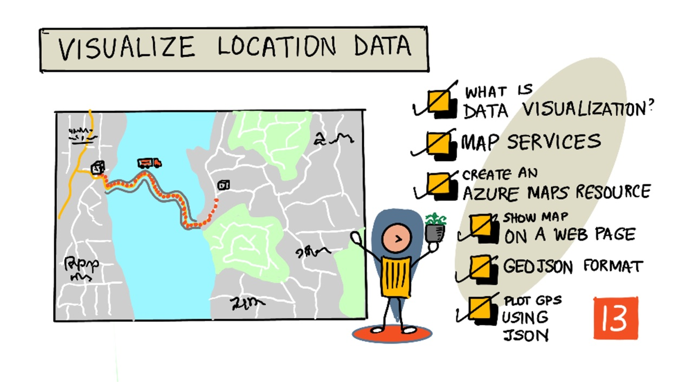
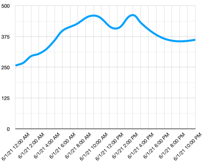
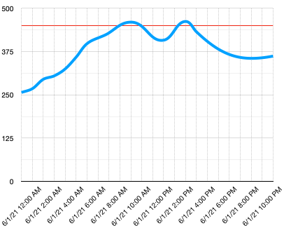
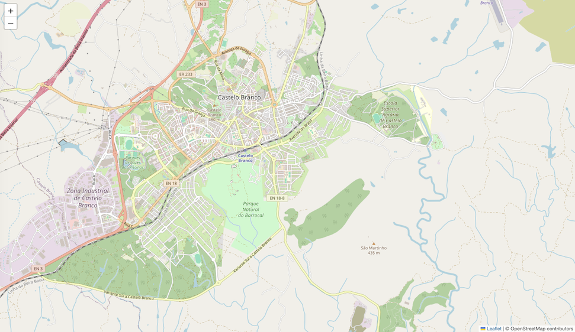
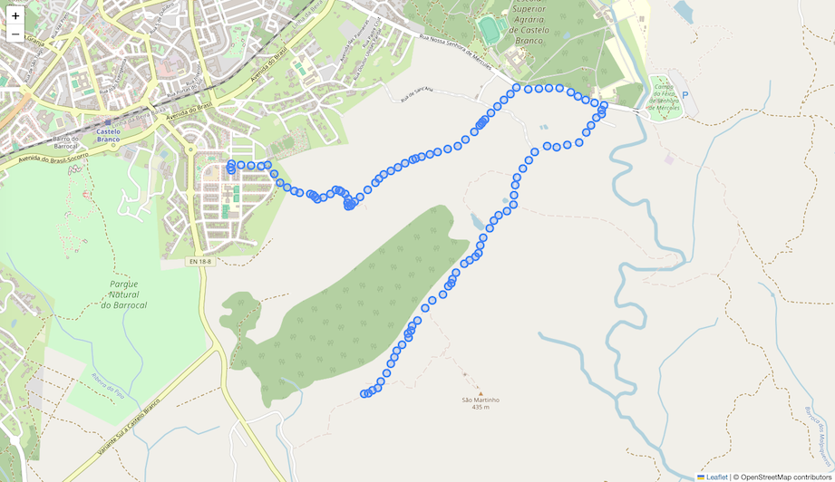

# Visualize location data



> Sketchnote by [Nitya Narasimhan](https://github.com/nitya). Click the image for a larger version.

## Introduction

In the last lesson you learned how to get GPS data from your sensors to save to the cloud in a storage container using serverless code. Now you will discover how to visualize those points on a map. You will learn how to create a map on a web page using the open source Leaflet library and OpenStreetMap tiles, learn about the GeoJSON data format and how to use it to plot all the captured GPS points on your map.

In this lesson we'll cover:

* [What is data visualization](#what-is-data-visualization)
* [Map services](#map-services)
* [Set up Leaflet and OpenStreetMap](#set-up-leaflet-and-openstreetmap)
* [Show a map on a web page](#show-a-map-on-a-web-page)
* [The GeoJSON format](#the-geojson-format)
* [Plot GPS data on a Map using GeoJSON](#plot-gps-data-on-a-map-using-geojson)

> 💁 This lesson will involve a small amount of HTML and JavaScript. If you would like to learn more about web development using HTML and JavaScript, check out [Web development for beginners](https://github.com/microsoft/Web-Dev-For-Beginners).

## What is data visualization

Data visualization, as the name suggests, is about visualizing data in ways that make it easier for humans to understand. It is usually associated with charts and graphs, but is any way of pictorially representing data to help humans to not only understand the data better, but help them make decisions.

Taking a simple example - back in the farm project you captured soil moisture settings. A table of soil moisture data captured every hour for the 1st June 2021 might be something like the following:

| Date             | Reading |
| ---------------- | ------: |
| 01/06/2021 00:00 |     257 |
| 01/06/2021 01:00 |     268 |
| 01/06/2021 02:00 |     295 |
| 01/06/2021 03:00 |     305 |
| 01/06/2021 04:00 |     325 |
| 01/06/2021 05:00 |     359 |
| 01/06/2021 06:00 |     398 |
| 01/06/2021 07:00 |     410 |
| 01/06/2021 08:00 |     429 |
| 01/06/2021 09:00 |     451 |
| 01/06/2021 10:00 |     460 |
| 01/06/2021 11:00 |     452 |
| 01/06/2021 12:00 |     420 |
| 01/06/2021 13:00 |     408 |
| 01/06/2021 14:00 |     431 |
| 01/06/2021 15:00 |     462 |
| 01/06/2021 16:00 |     432 |
| 01/06/2021 17:00 |     402 |
| 01/06/2021 18:00 |     387 |
| 01/06/2021 19:00 |     360 |
| 01/06/2021 20:00 |     358 |
| 01/06/2021 21:00 |     354 |
| 01/06/2021 22:00 |     356 |
| 01/06/2021 23:00 |     362 |

As a human, understanding that data can be hard. It's a wall of numbers without any meaning. As a first step to visualizing this data, it can be plotted on a line chart:



This can be further enhanced by adding a line to indicate when the automated watering system was turned on at a soil moisture reading of 450:



This chart shows very quickly not only what the soil moisture levels were, but the points where the watering system was turned on.

Charts are not the only tool to visualize data. IoT devices that track weather can have web apps or mobile apps that visualize weather conditions using symbols, such as a cloud symbol for cloudy days, a rain cloud for rainy days and so on. There are a huge number of ways to visualize data, many serious, some fun.

✅ Think about ways you've seen data visualized. Which methods have been the clearest and have allowed you to make decisions fastest?

The best visualizations allow humans to humans to make decisions quickly. For example, having a wall of gauges showing all manner of readings from industrial machinery is hard to process, but a flashing red light when something goes wrong allows a human to make a decision. Sometimes the best visualization is a flashing light!

When working with GPS data, the clearest visualization can be to plot the data on a map. A map showing delivery trucks for example, can help workers at a processing plant see when trucks will arrive. If this map shows more that just pictures of trucks at their current locations, but gives an idea of the contents of a truck, then the workers at the plant can plan accordingly - if they see a refrigerated truck close by they know to prepare space in a fridge.

## Map services

Working with maps is an interesting exercise, and there are many to choose from such as Bing Maps, Azure Maps, Leaflet, OpenStreetMap, and Google Maps. In this lesson, you will learn about [Leaflet](https://leafletjs.com) and [OpenStreetMap](https://www.openstreetmap.org) and how they can display your GPS data.

**OpenStreetMap** is a free, community-built map of the world. Its map images (called *tiles*) can be loaded without an account or an API key. **Leaflet** is a lightweight, open source JavaScript library that downloads those tiles, draws them on a web page and lets you add markers, lines, polygons and more on top.

> 💁 Both these tools are free and need no subscription. Azure Maps is a good alternative for production solutions that need features such as traffic, routing and search with an SLA. The GeoJSON you create in this lesson works with both.

You can control the behavior and look of your maps by enabling various controls to allow the map to react to events like pinch, drag, and click. To control the look of your map, you can add layers that include markers, lines, polygons, and more.

In this lesson, you will use Leaflet to draw a map and display your sensor's GPS location's path.

> ⚠️ OpenStreetMap tiles are free for light use, such as development and teaching. The [tile usage policy](https://operations.osmfoundation.org/policies/tiles/) forbids heavy traffic, and you must always show the attribution *© OpenStreetMap contributors* on the map. The code in this lesson does both.

## Set up Leaflet and OpenStreetMap

Your first step is to create an Azure Maps account.

### Task - check that you can reach the map libraries

1. Open the following addresses in your browser and confirm that each one loads (a block of code, or a small map tile image):

    - `https://unpkg.com/leaflet@1.9.4/dist/leaflet.js`
    - `https://tile.openstreetmap.org/0/0/0.png`

    If either one is blocked, your network may be filtering it.

## Show a map on a web page

Now you can take the next step which is to display your map on a web page. We will use just one `html` file for your small web app; keep in mind that in a production or team environment, your web app will most likely have more moving parts!

### Task - show a map on a web page

1. Create a file called `index.html` in a folder somewhere on your local computer. Add HTML markup to hold a map:

    ```html
    <html>
    <head>
        <style>
            #myMap {
                width:100%;
                height:100%;
            }
        </style>
    </head>
    
    <body onload="init()">
        <div id="myMap"></div>
    </body>
    </html>
    ```

    The map will load in the `myMap` `div`.  A few styles allow it to span the width and height of the page.

    > 🎓 a `div` is a section of a web page that can be named and styled.

1. Under the `<meta>` tag in the `<head>`, add an external style sheet to control the map display, and an external script from Leaflet to manage its behavior:

    ```html
    <link rel="stylesheet" href="https://unpkg.com/leaflet@1.9.4/dist/leaflet.css" />
    <script src="https://unpkg.com/leaflet@1.9.4/dist/leaflet.js"></script>
    ```

    This style sheet contains the settings for how the map looks, and the script file contains code to load the map. Adding this code is similar to including C++ header files or importing Python modules.

1. Under that script, add a script block to launch the map.

    ```javascript
    <script>
        async function init() {
            const center = [39.81556, -7.48182];
            const map = L.map('myMap').setView(center, 14);
            L.tileLayer('https://tile.openstreetmap.org/{z}/{x}/{y}.png', {
                maxZoom: 19,
                attribution: '&copy; OpenStreetMap contributors'
            }).addTo(map);
        }
    </script>
    ```

    If you open your `index.html` page in a web browser, you should see a map loaded, and focused on the `center` coordinates.

    

    ✅ Experiment with the zoom and center parameters to change your map display. You can add different coordinates corresponding to your data's latitude and longitude to re-center the map.

   > ⚠️ Leaflet uses `[latitude, longitude]` order, so the center in this code is `[39.81556, -7.48182]`.

> 💁 A better way to work with web apps locally is to install [http-server](https://www.npmjs.com/package/http-server). You will need [node.js](https://nodejs.org/) and [npm](https://www.npmjs.com/) installed before using this tool. Once those tools are installed, you can navigate to the location of your `index.html` file and type `http-server`. The web app will open on a local webserver [http://127.0.0.1:8080/](http://127.0.0.1:8080/).

## The GeoJSON format

Now that you have your web app in place with the map displaying, you need to extract GPS data from your storage account and display it in a layer of markers on top of the map. Before we do that, let's look at the [GeoJSON](https://wikipedia.org/wiki/GeoJSON) format, which Leaflet can read directly.

[GeoJSON](https://geojson.org/) is an open standard JSON specification with special formatting designed to handle geographic-specific data. You can learn about it by testing sample data using [geojson.io](https://geojson.io), which is also a useful tool to debug GeoJSON files.

Sample GeoJSON data looks like this:

```json
{
  "type": "FeatureCollection",
  "features": [
    {
      "type": "Feature",
      "geometry": {
        "type": "Point",
        "coordinates": [
          -2.10237979888916,
          57.164918677004714
        ]
      }
    }
  ]
}
```

Of particular interest is the way the data is nested as a `Feature` within a `FeatureCollection`. Within that object can be found `geometry` with the `coordinates` indicating latitude and longitude.

✅ When building your geoJSON, pay attention to the order of `latitude` and `longitude` in the object, or your points will not appear where they should! GeoJSON expects data in the order `lon,lat` for points, not `lat,lon`.

`Geometry` can have different types, such as a single point or a polygon. In this example, it is a point with two coordinates specified, the longitude, and the latitude.

✅ Leaflet's `L.geoJSON` function reads standard GeoJSON and swaps the coordinates into the `[lat, lon]` order that the rest of Leaflet uses, so you only have to follow the GeoJSON rule when you build your data.

## Plot GPS data on a Map using GeoJSON

Now you are ready to consume data from the storage that you built in the previous lesson. As a reminder, it is stored as a number of files in blob storage so you will need to retrieve the files and parse them so that Leaflet can use the data.

### Task - configure storage to be accessed from a web page

If you make a call to your storage to fetch the data you might be surprised to see errors occurring in your browser's console. That's because you need to set permissions for [CORS](https://developer.mozilla.org/docs/Web/HTTP/CORS) on this storage to allow external web apps to read its data.

> 🎓 CORS stands for "Cross-Origin Resource Sharing" and usually needs to be set explicitly in Azure for security reasons. It stops sites you don't expect from being able to access your data.

1. First, get the storage account key by running the following command:

   ```sh
   az storage account keys list --output table \
                                --account-name <storage_name>
   ```

   Replace `<storage_name>` with the name of the storage account.

   Copy the value of `key1`.

1. Run the following command to enable CORS:

    ```sh
    az storage cors add --methods GET \
                        --origins "*" \
                        --services b \
                        --account-name <storage_name> \
                        --account-key <key1>
    ```

    Replace `<storage_name>` with the name of your storage account. Replace `<key1>` with the account key for your storage account.

    This command allows any website (the wildcard `*` means any) to make a *GET* request, that is get data, from your storage account. The `--services b` means only apply this setting for blobs.

### Task - load the GPS data from storage

1. Replace the entire contents of the `<script>` with the `init` function in `index.html` file with the following code. The map code from the previous task is kept, and the code that loads the blobs is added below it:

    ```javascript
    const containerUrl = "https://<storage_name>.blob.core.windows.net/gps-data/";

    async function init() {
        // The map, as before
        const center = [39.81556, -7.48182];
        const map = L.map('myMap').setView(center, 14);
        L.tileLayer('https://tile.openstreetmap.org/{z}/{x}/{y}.png', {
            maxZoom: 19,
            attribution: '&copy; OpenStreetMap contributors'
        }).addTo(map);

        // The GPS data
        const blobUrls = await listBlobs();
        console.log("Blobs found:", blobUrls.length);

        const features = await readFeatures(blobUrls);
        console.log("Valid points:", features.length);

        // Draw every GeoJSON point as a circle on the map
        const layer = L.geoJSON(
            { type: "FeatureCollection", features: features },
            { pointToLayer: (feature, latlng) => L.circleMarker(latlng, { radius: 6 }) }
        ).addTo(map);

        if (features.length > 0) {
            map.fitBounds(layer.getBounds(), { maxZoom: 17 });
        }
    }
    ```

    Replace `<storage_name>` with the name of your storage account.

    The code builds the map, fetches the list of blobs, loads each one and converts it to GeoJSON, then adds all the points to the map in a single layer. The `console.log` lines help you find problems: open your browser's developer tools (press `F12`) and look at the *Console* tab.

1. Add the `listBlobs` and `readFeatures` functions to your script block in `index.html` file, below the `init` function:

    ```javascript
    async function listBlobs() {
        const xml = await fetch(containerUrl + "?restype=container&comp=list")
            .then(response => response.text())
            .then(str => new window.DOMParser().parseFromString(str, "text/xml"));
        return Array.from(xml.querySelectorAll("Url")).map(url => url.textContent);
    }

    async function readFeatures(urls) {
        const features = await Promise.all(urls.map(async url => {
            try {
                const gps = (await (await fetch(url)).json()).gps;
                const lon = parseFloat(gps.lon);
                const lat = parseFloat(gps.lat);
                if (isNaN(lon) || isNaN(lat)) return null;

                // GeoJSON order is [longitude, latitude]
                return {
                    type: "Feature",
                    geometry: { type: "Point", coordinates: [lon, lat] }
                };
            } catch (e) {
                console.warn("Could not read", url, e);
                return null;
            }
        }));
        return features.filter(feature => feature !== null);
    }    
    ```

    `listBlobs` calls the storage container with `restype=container&comp=list`, which returns information about all the blobs. This list won't return the blobs themselves, but will return a `Url` for each blob that can be used to load the blob data.

    > 💁 You can put the container URL into your browser to see details of all the blobs in your container. Each item will have a `Url` property that you can also load in your browser to see the contents of the blob.

    `readFeatures` loads all the blobs at the same time, and waits until every one has finished before returning. This is important: if the map were drawn before the data had arrived, some or all of the points would be missing. Each blob is converted to a GeoJSON `Feature`, with the coordinates in `[lon, lat]` order, and any blob that can't be read is skipped.

1. Load the HTML page in your browser. It will load the map, then load all the GPS data from storage and plot it on the map.

    

> 💁 You can find this code in the [code](./code) folder.

---

## 🚀 Challenge

It's nice to be able to display static data on a map as markers. Can you enhance this web app to show the path of the markers over time, using the timestamped json files? Hint: sort the points by their timestamp and draw them as a line with `L.polyline`. To go further, look at the animated marker examples in the [Leaflet plugins list](https://leafletjs.com/plugins.html).

## Review & Self Study

* Learn more about the library in the [Leaflet quick start guide](https://leafletjs.com/examples/quick-start/).
* See how Leaflet handles GeoJSON in the [Using GeoJSON with Leaflet tutorial](https://leafletjs.com/examples/geojson/).
* If you want to try a commercial mapping service later, Azure Maps is particularly useful for working with IoT devices. Research some of the uses in the [Azure Maps documentation on Microsoft docs](https://docs.microsoft.com/azure/azure-maps/tutorial-iot-hub-maps?WT.mc_id=academic-17441-jabenn).

## Assignment

[Deploy your app](assignment.md)
