# Train a fruit quality detector

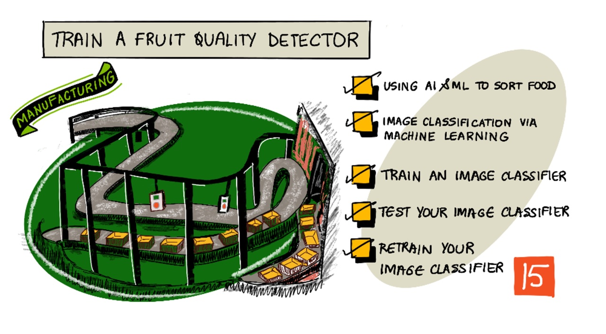

> Sketchnote by [Nitya Narasimhan](https://github.com/nitya). Click the image for a larger version.

## Introduction

The recent rise in Artificial Intelligence (AI) and Machine Learning (ML) is providing a wide range of capabilities to todays developers. ML models can be trained to recognize different things in images, including unripe fruit, and this can be used in IoT devices to help sort produce either as it is being harvested, or during processing in factories or warehouses.

In this lesson you will learn about image classification - using ML models to distinguish between images of different things. You will learn how to train an image classifier to distinguish between fruit that is good, and fruit that is bad, either under or over ripe, bruised, or rotten.

In this lesson we'll cover:

* [Using AI and ML to sort food](#using-ai-and-ml-to-sort-food)
* [Image classification via Machine Learning](#image-classification-via-machine-learning)
* [Train an image classifier](#train-an-image-classifier)
* [Test your image classifier](#test-your-image-classifier)
* [Retrain your image classifier](#retrain-your-image-classifier)

## Using AI and ML to sort food

Feeding the global population is hard, especially at a price that makes food affordable for all. One of the largest costs is labor, so farmers are increasingly turning to automation and tools like IoT to reduce their labor costs. Harvesting by hand is labor intensive (and often backbreaking work), and is being replaced by machinery, especially in richer nations. Despite the savings in cost of using machinery to harvest, there is a downside - the ability to sort food as it is being harvested.

Not all crops ripen evenly. Tomatoes, for example, can still have some green fruits on the vine when the majority is ready for harvest. Although it is a waste to harvest these early, it is cheaper and easier for the farmer to harvest everything using machinery and dispose of the unripe produce later.

✅ Have a look at different fruits or vegetables, either growing near you in farms or in your garden, or in shops, Are they all the same ripeness, or do you see variation?

The rise of automated harvesting moved the sorting of produce from the harvest to the factory. Food would travel on long conveyer belts with teams of people picking over the produce removing anything that wasn't up to the required quality standard. Harvesting was cheaper thanks to machinery, but there was still a cost to manually sort food.

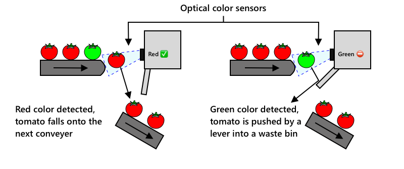

The next evolution was to use machines to sort, either built into the harvester, or in the processing plants. The first generation of these machines used optical sensors to detect colors, controlling actuators to push green tomatoes into a waste bin using levers or puffs of air, leaving red tomatoes to continue on a network of conveyor belts.

In this video, as tomatoes fall from one conveyer belt to another, green tomatoes are detected and flicked into a bin using levers.

✅ What conditions would you need in a factory or in a field for these optical sensors to work correctly?

The latest evolutions of these sorting machines take advantage of AI and ML, using models trained to distinguish good produce from bad, not just by obvious color differences such as green tomatoes vs red, but by more subtle differences in appearance that can indicate disease or bruising.

## Image classification via Machine Learning

Traditional programming is where you take data, apply an algorithm to the data, and get output.

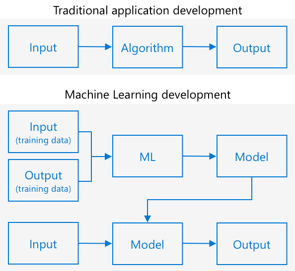

Machine learning turns this around - you start with data and known outputs, and the machine learning algorithm learns from the data. You can then take that trained algorithm, called a *machine learning model* or *model*, and input new data and get new output.

> 🎓 The process of a machine learning algorithm learning from the data is called *training*. The inputs and known outputs are called *training data*.

For example, you could give a model millions of pictures of unripe bananas as input training data, with the training output set as `unripe`, and millions of ripe banana pictures as training data with the output set as `ripe`. The ML algorithm will then create a model based off this data. You then give this model a new picture of a banana and it will predict if the new picture is a ripe or an unripe banana.

> 🎓 The results of ML models are called *predictions*

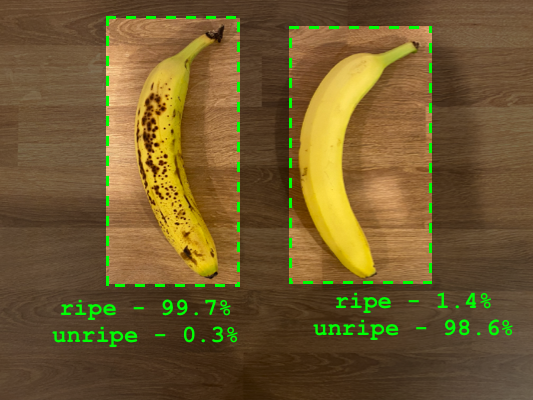

ML models don't give a binary answer, instead they give probabilities. For example, a model may be given a picture of a banana and predict `ripe` at 99.7% and `unripe` at 0.3%. Your code would then pick the best prediction and decide the banana is ripe.

The ML model used to detect images like this is called an *image classifier* - it is given labelled images, and then classifies new images based off these labels.

> 💁 This is an over-simplification, and there are many other ways to train models that don't always need labelled outputs, such as unsupervised learning. If you want to learn more about ML, check out [ML for beginners, a 24 lesson curriculum on Machine Learning](https://aka.ms/ML-beginners).

## Train an image classifier

To successfully train an image classifier you need millions of images. As it turns out, once you have an image classifier trained on millions or billions of assorted images, you can re-use it and re-train it using a small set of images and get great results, using a process called *transfer learning*.

> 🎓 Transfer learning is where you transfer the learning from an existing ML model to a new model based off new data.

Once an image classifier has been trained for a wide variety of images, it's internals are great at recognizing shapes, colors and patterns. Transfer learning allows the model to take what it has already learned in recognizing image parts, and use that to recognize new images.

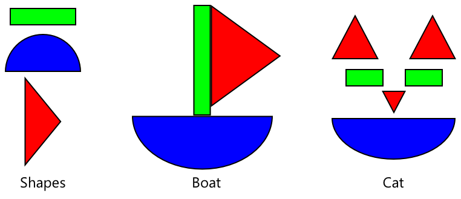

You can think of this as a bit like children's shape books, where once you can recognize a semi-circle, a rectangle and a triangle, you can recognize a sailboat or a cat depending on the configuration of these shapes. The image classifier can recognize the shapes, and the transfer learning teaches it what combination makes a boat or a cat - or a ripe banana.

There are a wide range of tools that can help you do this, including cloud-based services that can help you train your model, then use it via web APIs.

> 💁 Training these models takes a lot of computer power, usually via Graphics Processing Units, or GPUs. The same specialized hardware that makes games on your Xbox look amazing can also be used to train machine learning models. By using the cloud you can rent time on powerful computers with GPUs to train these models, getting access to the computing power you need, just for the time you need it.

## Roboflow

[Roboflow](https://roboflow.com) is a cloud-based platform for building computer vision models. It lets you upload images through a web portal, label them, train a model using transfer learning, test it, and then use it through a web API or an SDK.

> 💁 You can train a classifier with as little as 5 images per class, but more is better. You can get better results with at least 30 images per class.

> 💁 Roboflow has a free tier that is enough to create a model, train it, and use it for development work. Limits (number of images, training credits, and whether projects are public) change over time, so check the [Roboflow pricing page](https://roboflow.com/pricing) before starting, especially if students will use their own photos.

### Task - create a Roboflow account and workspace

1. Go to [roboflow.com](https://roboflow.com) and create a free account.

1. Create a workspace when prompted.

### Task - create an image classifier project

1. In your workspace, select **Create New Project**.

1. Name the project `fruit-quality-detector`.

1. Set the project type to **Classification** and choose **Single-Label** (each image has exactly one tag, such as `ripe` or `unripe`).

> 💁 The user interface may change over time. The [Roboflow documentation](https://docs.roboflow.com) is always the most up to date reference.

✅ Take some time to explore the Roboflow UI for your project.

### Task - train your image classifier project

To train an image classifier, you will need multiple pictures of fruit, both good and bad quality to tag as good and bad, such as a ripe and an overripe banana.

> 💁 These classifiers can classify images of anything, so if you don't have fruit to hand of differing quality, you can use two different types of fruit, or cats and dogs!

Ideally each picture should be just the fruit, with either a consistent background, or a wide variety of backgrounds. Ensure there's nothing in the background that is specific to ripe vs unripe fruit.

> 💁 It's important not to have specific backgrounds, or specific items that are not related to the thing being classified for each tag, otherwise the classifier may just classify based on the background. There was a classifier for skin cancer that was trained on moles both normal and cancerous, and the cancerous ones all had rulers against them to measure the size. It turned out the classifier was almost 100% accurate at identifying rulers in pictures, not cancerous moles.

Image classifiers run at low resolution. Larger images are shrunk before training and prediction, so ensure the thing you are classifying takes up a large part of the image, otherwise it may be too small in the smaller image used by the classifier.

1. Gather pictures for your classifier. You will need at least 5 pictures for each class to train the classifier, but the more the better. You will also need a few additional images to test the classifier. These images should all be different images of the same thing. You can also find some example images in the [images](./images) folder of ripe and unripe bananas that you can use.

   You should have at least 10 training images, with at least 5 ripe and 5 unripe, and 4 testing images, 2 ripe, 2 unripe. Your images should be png or jpeg. The more images the better, and you should have a similar number of ripe and unripe.

   > 💁 **Keep your test images separate.** Do not upload the test images to the project yet. You will use them later to check how the model behaves on images it has never seen.

1. In your project, open the **Upload** area and upload your training images in two separate batches, naming them `ripe` and `unripe` (for identification purposes only). Then, in the **Annotate** area, assign the class `ripe` to the ripe batch and `unripe` to the unripe batch using the **Label manually** option.

	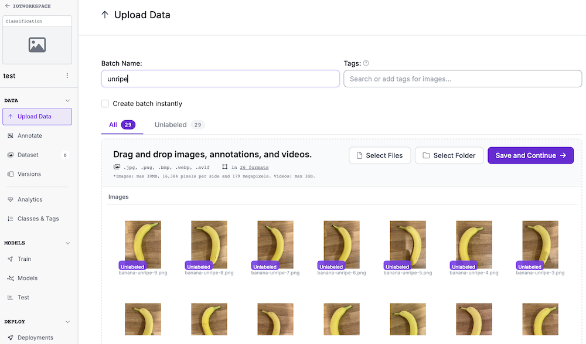 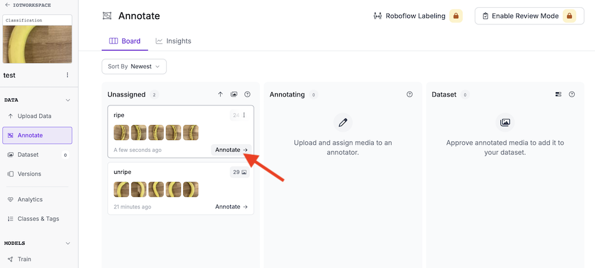
	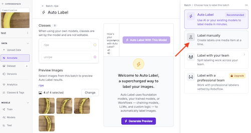 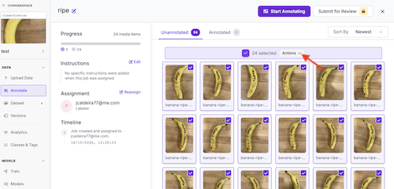
	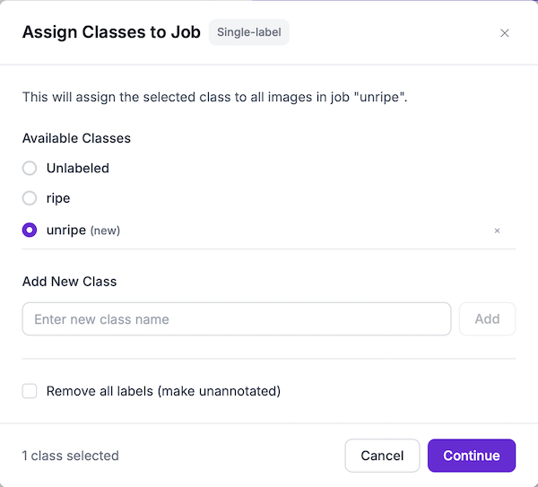

   > 💁 It is easier to upload all images of one class at a time and assign the class during upload, rather than tagging them one by one afterwards.

1. It is now time to create a version of your dataset for training. Open the **Versions** area in your project and click **Add Annotated Images** to add the images from the previous step to your dataset.

   > 💁 Roboflow divides your images into **train**, **validation** and **test** sets. With a very small dataset, make sure every set contains images of both classes. If the split puts all images of one class in the same set, adjust it.

1. Back in the **Versions** area, everything is ready to start training. Click **Train a Model**. You can adjust some parameters, but for this lesson you can keep the defaults.

1. Start training from the version page, choosing Roboflow's hosted training. When asked, start from a pre-trained checkpoint so that transfer learning is used.

The classifier will then train. It can take several minutes for the training to complete.

> 🍌 If you decide to eat your fruit whilst the classifier is training, make sure you have enough images to test with first!

## Test your image classifier

Once your classifier is trained, you can test it by giving it a new image to classify.

### Task - test your image classifier

1. Open your trained model and use the option to try it on an image (the visual testing / deploy preview). Upload one of the testing images you set aside earlier.

1. Try all the testing images you have access to and observe the probabilities.

   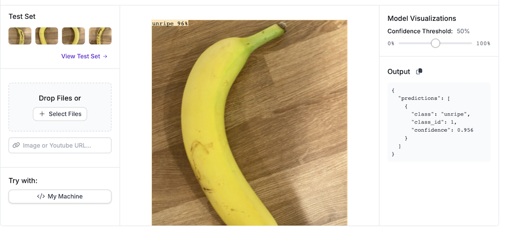

1. Look at the model's evaluation metrics shown after training (for example accuracy, precision and recall).

## Retrain your image classifier

When you test your classifier, it may not give the results you expect. Image classifiers use machine learning to make predictions about what is in an image, based on probabilities that particular features of an image mean that it matches a particular label. It doesn't understand what is in the image - it doesn't know what a banana is or understand what makes a banana a banana instead of a boat. You can improve your classifier by retraining it with images it gets wrong.

### Task - retrain your image classifier

1. Take the images the model classified incorrectly (or with low confidence) and upload them to your project with the **correct** class.

1. Create a new dataset version and train the model again.

1. Once your model has been retrained, test it on new images and compare the results with the first version.

---

## 🚀 Challenge

What do you think would happen if you used a picture of a strawberry with a model trained on bananas, or a picture of an inflatable banana, or a person in a banana suit, or even a yellow cartoon character like someone from the Simpsons?

Try it out and see what the predictions are. You can find images to try with using [Bing Image search](https://www.bing.com/images/trending).

## Review & Self Study

* When you trained your classifier, you will have seen evaluation metrics such as *accuracy*, *precision* and *recall*. Read up on what these values are, for example in the [Roboflow documentation](https://docs.roboflow.com) and in the [ML for beginners](https://aka.ms/ML-beginners) curriculum.
* Read up on how to improve a classifier: more images, more varied backgrounds and lighting, balanced classes, and augmentation.

## Assignment

[Train your classifier for multiple fruits and vegetables](assignment.md)
