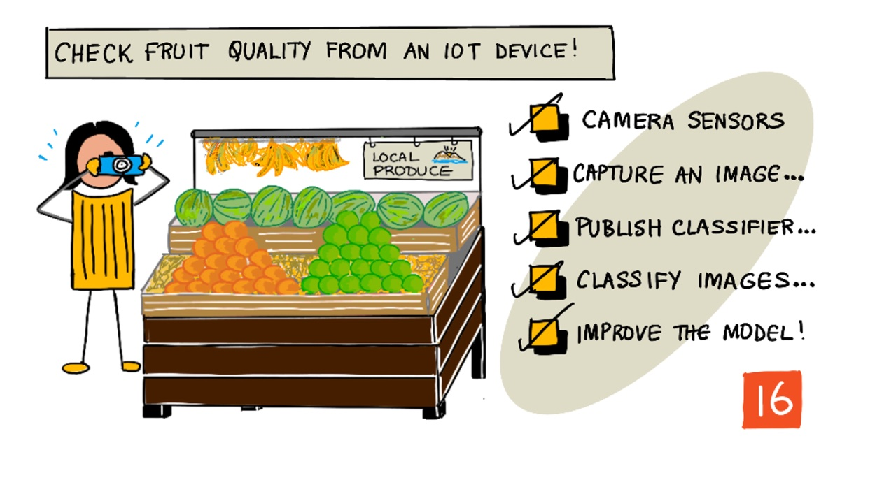
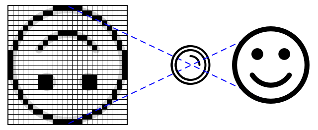

# Check fruit quality from an IoT device

> Sketchnote by [Nitya Narasimhan](https://github.com/nitya). Click the image for a larger version.

## Introduction

In the last lesson you learned about image classifiers, and how to train them to detect good and bad fruit. To use this image classifier in an IoT application, you need to be able to capture an image using some kind of camera, and send this image to the cloud to be classified.

In this lesson you will learn about camera sensors, and how to use them with an IoT device to capture an image. You will also learn how to call the image classifier from your IoT device.

In this lesson we'll cover:

* [Camera sensors](#camera-sensors)
* [Capture an image using an IoT device](#capture-an-image-using-an-iot-device)
* [Classify images from your IoT device](#classify-images-from-your-iot-device)

## Camera sensors

Camera sensors, as the name suggests, are cameras that you can connect to your IoT device. They can take still images, or capture streaming video. Some will return raw image data, others will compress the image data into an image file such as a JPEG or PNG. Usually the cameras that work with IoT devices are much smaller and lower resolution than what you might be used to, but you can get high resolution cameras that will rival top end phones. You can get all manner of interchangeable lenses, multiple camera setups, infra-red thermal cameras, or UV cameras.

Most camera sensors use image sensors where each pixel is a photodiode. A lens focuses the image onto the image sensor, and thousands or millions of photodiodes detect the light falling on each one, and record that as pixel data.

> 💁 Lenses invert images, the camera sensor then flips the image back the right way round. This is the same in your eyes - what you see is detected upside down on the back of your eye and your brain corrects it.

> 🎓 The image sensor is known as an Active-Pixel Sensor (APS), and the most popular type of APS is a complementary metal-oxide semiconductor sensor, or CMOS. You may have heard the term CMOS sensor used for camera sensors.

Camera sensors are digital sensors, sending image data as digital data, usually with the help of a library that provides the communication. Cameras connect using protocols like SPI to allow them to send large quantities of data - images are substantially larger than single numbers from a sensor such as a temperature sensor.

✅ What are the limitations around image size with IoT devices? Think about the constraints especially on microcontroller hardware.

## Capture an image using an IoT device

You can use your IoT device to capture an image for classification. Since you don't have a physical camera connected to your ESP32, you will use image files instead for this lesson.

## Classify images from your IoT device

You will now go through the steps required to call the image classifier from your IoT device.

### Task - classify images from your IoT device

Work through the relevant guide to classify images using your IoT device:

* **[Microcontroller ESP32](esp32-classify-image.md) <<<<----------**

---

## 🚀 Challenge

How much does image resolution or lighting affect the prediction?

Try changing the resolution of the images in your device code and see if it makes a difference to the quality of the images. Also try changing lighting.

If you were to create a production device to sell to farms or factories, how would you ensure it gives consistent results all the time?

## Assignment

[Respond to classification results](assignment.md)
