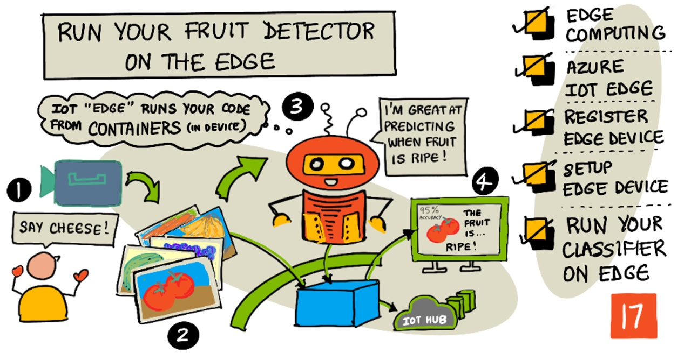
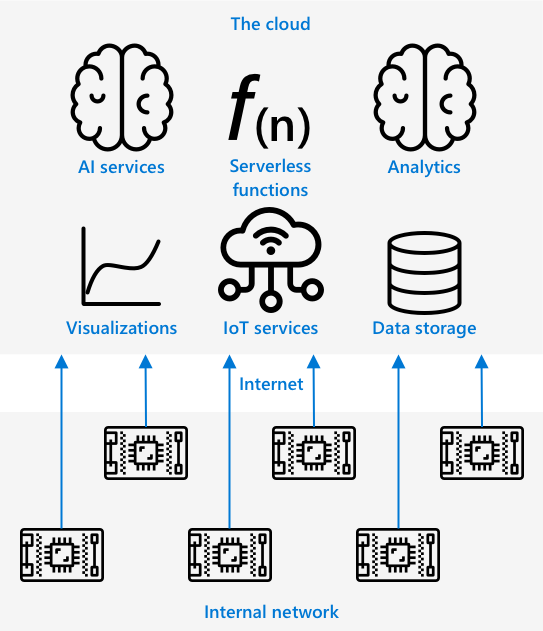
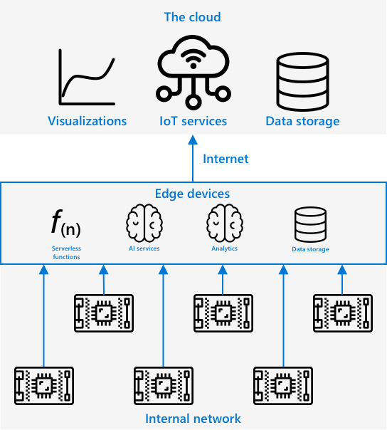
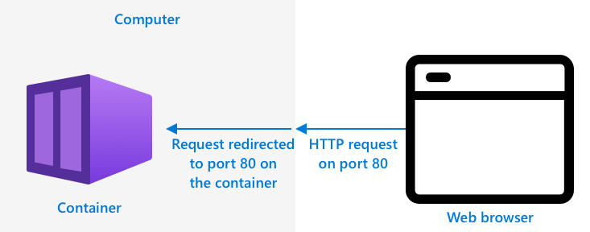

# Run your fruit detector on the edge



> Sketchnote by [Nitya Narasimhan](https://github.com/nitya). Click the image for a larger version.

> 💁 This version runs your classifier on the edge with the open source [Roboflow Inference](https://inference.roboflow.com) server, in a Docker container on a Linux virtual machine. The concepts are the same, only the tools change.

## Introduction

In the last lesson you used your image classifier to classify ripe and unripe fruit, sending an image from your IoT device over the internet to a cloud service. These calls take time, cost money, and depending on the kind of image data you are using, could have privacy implications.

In this lesson you will learn about how to run machine learning (ML) models on the edge - on computers running on your own network rather than in the cloud. You will learn the benefits and drawbacks of edge computing versus cloud computing, how to run your AI model on an edge server, and how to access it from your IoT device.

In this lesson we'll cover:

* [Edge computing](#edge-computing)
* [Roboflow Inference](#roboflow-inference)
* [Prepare the edge device](#prepare-the-edge-device)
* [Install the Inference server](#install-the-inference-server)
* [Run your model on the edge](#run-your-model-on-the-edge)
* [Expose the server to your network](#expose-the-server-to-your-network)
* [Use your edge device](#use-your-edge-device)

## Edge computing

Edge computing involves having computers that process IoT data as close as possible to where the data is generated. Instead of having this processing in the cloud, it is moved to the edge of the cloud - your internal network.



In the lessons so far, you have had devices gathering data and sending data to the cloud to be analyzed, running serverless functions or AI models in the cloud.



Edge computing involves moving some of the cloud services off the cloud and onto computers running on the same network as the IoT devices, only communicating with the cloud if needed. For example, you can run AI models on edge devices to analyse fruit for ripeness, and only send analytics back to the cloud, such as the number of ripe pieces of fruit vs unripe.

✅ Think about the IoT applications you have built so far. Which parts of them could be moved to the edge.

### Upsides

The upsides of edge computing are:

1. **Speed** - edge computing is ideal for time-sensitive data as actions are done on the same network as the device, rather than making calls across the internet. This enables higher speeds as internal networks can run at substantially faster speeds than internet connections, with the data travelling much shorter distance.

    > 💁 Despite optical cables being used for internet connections allowing data to travel at the speed of light, data can take time to travel around the world to cloud providers. For example, if you are sending data from Europe to cloud services in the US it takes at least 28ms for the data to cross the atlantic in an optical cable, and that is ignoring the time taken to get the data to the transatlantic cable, convert from electrical to light signals and back again the other side, then from the optical cable to the cloud provider.

    Edge computing also requires less network traffic, reducing the risk of your data slowing down due to congestion on the limited bandwidth available for an internet connection.

1. **Remote accessibility** - edge compute works when you have limited or no connectivity, or connectivity is too expensive to use continually. For example when working in humanitarian disaster areas where infrastructure is limited, or in developing nations.

1. **Lower costs** - performing data collection, storage, analysis, and triggering actions on edge device reduces usage of cloud services which can reduce the overall cost of your IoT application. There has been a recent rise in devices designed for edge computing, such as AI accelerator boards like the [Jetson Nano from NVIDIA](https://developer.nvidia.com/embedded/jetson-nano-developer-kit), which can run AI workloads using GPU-based hardware on devices that cost less than US$100.

1. **Privacy and security** - with edge compute, data stays on your network and is not uploaded to the cloud. This is often preferred for sensitive and personally identifiable information, especially because data does not need to be stored after it has been analyzed, which greatly reduces the risk of data leaks. Examples include medical data and security camera footage.

1. **Handling insecure devices** - if you have devices with known security flaws that you don't want to connect directly to your network or the internet, then you can connect them to a separate network to a gateway IoT Edge device. This edge device can then also have a connection to your wider network or the internet, and manage the data flows back and forth.

1. **Support for incompatible devices** - if you have devices that cannot connect to IoT Hub, for example devices that can only connect using HTTP connections or devices that only have Bluetooth to connect, you can use an IoT edge device as a gateway device, forwarding on messages to IoT Hub.

✅ Do some research: What other upsides might there be to edge computing?

### Downsides

There are downsides to edge computing, where the cloud may be a preferred option:

1. **Scale and flexibility** - cloud computing can adjust to network and data needs in real-time by adding or reducing servers and other resources. To add more edge computers requires manually adding more devices.

1. **Reliability and resiliency** - cloud computing provides multiple servers often in multiple locations for redundancy and disaster recovery. To have the same level of redundancy on the edge requires large investments and a lot of configuration work.

1. **Maintenance** - cloud service providers provide system maintenance and updates.

✅ Do some research: What other downsides might there be to edge computing?

The downsides are really the opposite of the upsides of using the cloud - you have to build and manage these devices yourself, rather than relying on the expertise and scale of cloud providers.

Some of the risks are mitigated by the very nature of edge computing. For example, if you have an edge device running in a factory gathering data from machinery, you don't need to think about some disaster recovery scenarios. If the power to the factory goes out then you don't need a backup edge device as the machines that generate the data the edge device processes will also be without power.

For IoT systems, you'll often want a blend of cloud and edge computing, leveraging each service based on the needs of the system, its customers, and its maintainers.

## Roboflow Inference

Roboflow Inference is an open source server that runs your Roboflow models and workflows on your own hardware. You run it as a *container* - a self contained application that is run in isolation from the rest of the applications on your computer. When you run a container it acts like a separate computer running inside your computer, with its own software, services and applications running. Most of the time containers cannot access anything on your computer unless you choose to share things like a folder with the container. The container then exposes services via an open port that you can connect to or expose to your network.



For example, you can have a container with a web site running on port 80, the default HTTP port, and you can then expose it from your computer also on port 80. The Inference server listens on port 9001.

✅ Do some research: Read up on containers and services such as Docker or Moby.

Once the Inference server is running, you call it with the same REST API as the cloud version, but with the address pointing to the edge device. You don't have to export or download your model manually: the first time you call your workflow, the server downloads the workflow and the model weights from Roboflow, using your API key, and keeps them in a local cache.

> 💁 This means the edge server needs internet access and your API key at least for the first call. Later calls use the cached model. If you want to rely on offline operation, test it by disconnecting the server from the internet after a successful call.

## Prepare the edge device

The Inference server runs in Docker, so you need a Linux computer. In this lesson the edge device is a virtual machine (VM) running Ubuntu 24.04. You could also use a Raspberry Pi or any other Linux computer on your network.

An IoT device such as the ESP32 has to reach the edge device over your local network. A VM, however, uses by default a network mode called **NAT**: the VM gets a private address (for example `10.0.2.15`) that only the computer hosting the VM can see, so your ESP32 can never reach it. You need to put the VM on your network.

### Task - put the VM on your network (bridge mode)

In *bridge* mode the VM gets its own IP address on your network, just like a physical computer.

1. **Shut down the VM**, then change its network settings:

    - **VirtualBox menu**: *Settings > Network > Adapter 1 > Attached to: Bridged Adapter*, then choose the physical network adapter your computer is using (Wi-Fi or Ethernet).

2. Start the VM and find its IP address::

    ```sh
    hostname -I
    ```

    The first three numbers should be the same as the IP address of your ESP32 (for example `192.168.1.x` on both). If the address starts with `10.0.2.`, the VM is still in NAT mode. If it starts with `169.254.`, the VM didn't get an address from your network.

    > 💁 If `hostname -I` shows several addresses, use the one on your local network. Addresses that start with `172.17.` or `172.18.` belong to Docker and cannot be used from the ESP32.

3. From your host computer (not from the VM), check that the VM can be reached:

    ```sh
    ping <ip address of the VM>
    ```

> ⚠️ Bridge mode over **Wi-Fi** doesn't work with some Wi-Fi adapters and access points, because they only accept one MAC address per client. The VM may get an IP address but no traffic passes. If this happens, connect your host computer using an Ethernet cable and bridge to that adapter, or use a phone hotspot or your own router for your host, the VM and the ESP32.

> 💁 If you cannot use bridge mode, keep NAT and create a *port forwarding* rule for TCP port 9001 (in VirtualBox: *Network > Advanced > Port Forwarding*, host port `9001`, guest port `9001`). Your ESP32 then connects to the IP address of the **host computer** instead of the VM. If the host is Windows, allow port 9001 in its firewall.

## Install the Inference server

### Task - install the Inference CLI


1. Install the Inference CLI and SDK:

    ```sh
    pip3 install inference-cli inference-sdk
    ```

## Run your model on the edge

### Task - gather your Roboflow details

You need three things from your Roboflow account:

- **API key** - in the settings of your workspace.
- **Workspace name** - it appears in the URL, `app.roboflow.com/<workspace>/...`.
- **Workflow ID** - in the *Deploy* panel of your fruit quality workflow.

### Task - start the server

1. Start the inference server. **This command may take longer to complete**:

    ```sh
    inference server start
    ```

    You can check the server status using the following commands:

    ```sh
    inference server status
    ```

1. Check that the container is running and which address the port is published on:

    ```sh
    docker ps
    ss -ltn | grep 9001
    ```

    > ⚠️ By default the server only listens on the loopback address, so `ss` shows `127.0.0.1:9001`. This means that only programs inside the VM can reach it. Your ESP32 cannot connect, and you will get connection errors such as `ECONNRESET`. The next section shows how to fix this.

### Task - test the classifier inside the VM

1. Inside your VM, create a file called `test.py`:

    ```python
    from inference_sdk import InferenceHTTPClient

    client = InferenceHTTPClient(
        api_url="http://localhost:9001",
        api_key="<api key>"
    ).configure(InferenceConfiguration(api_key_transport="header"))

    result = client.run_workflow(
        workspace_name="<workspace>",
        workflow_id="<workflow id>",
        images={"image": "<image file>"}
    )
    pred = result[0]["predictions"]
	print(pred["top"], ":", round(pred["confidence"] * 100, 2),"%")
    ```

    Replace `<api key>`, `<workspace>` and `<workflow id>` with your values, and `<image file>` with the path to a ripe or unripe fruit image. This code uses the inference SDK to call the local inference server and send it an image for classification.

    > 💁 The response from a workflow can contain several outputs, if you want to print the full response instead, add the following instruction `print(result)`.

1. Run it:

    ```sh
    python3 test.py
    ```

    **The first call takes longer**, because the server downloads your workflow and model from Roboflow. After that, the model is kept in the server's cache, and calls are faster.

## Expose the server to your network

Now that the server works inside the VM, make it reachable from other devices on your network.

### Task - bind the server to the network

1. Stop the server and start it again, telling it which address to listen on:

    ```sh
    inference server stop
    inference server start --bind-address 0.0.0.0
    ```

    `0.0.0.0` means all network interfaces. For better security you can use only the IP address of the VM on your local network, for example `--bind-address 192.168.1.50`, so the server only accepts connections on that interface.

2. Check that the port is now published on the network:

    ```sh
    ss -ltn | grep 9001
    ```

    You should see `0.0.0.0:9001` (or `*:9001`) instead of `127.0.0.1:9001`.

> ⚠️ **Security**: the Inference server has no authentication, and anyone who can submit a workflow to it can run code on the machine. Only expose it on a network that you trust, never to the internet or to a shared network or guest network. You can stop the server with `inference server stop` when you are not using it.

### Task - test the server from another computer

1. From your host computer, or from another device on the same network, run:

    ```sh
    curl http://<ip address of the VM>:9001/
    ```

    Replace `<ip address of the VM>` with the address from `hostname -I`. If the server answers, you can reach it from your network. You can also open the same address in a browser.

## Use your IoT Edge device

Now that your Image Classifier has been deployed to the IoT Edge device, you can use it from your IoT device.

### Task - use your IoT Edge device

Work through the relevant guide to classify images using the IoT Edge classifier:

* **[Microcontroller ESP32](esp32-classify-edge.md) <<<<----------**

### Model retraining

One of the downsides to running image classifiers on the edge is that they are not connected to your Roboflow project. The images that were classified using the edge server are not sent to the cloud, so you won't see them in your project.

This is the expected behavior - images are not sent to the cloud for classification, so they won't be available in the cloud. One of the upsides of using the edge is privacy, ensuring that images don't leave your network, another is being able to work offline, so no relying on uploading images when the device has no internet connection. The downside is improving your model - you would need to implement another way of storing images that can be manually re-classified to improve and re-train the image classifier.

✅ Think about ways to upload images to retrain the classifier.

---

## 🚀 Challenge

Running AI models on edge devices can be faster than in the cloud - the network hop is shorter. They can also be slower, as the hardware that runs the model may not be as powerful as the cloud.

Do some timings and compare if the call to your edge device is faster or slower than the call to the cloud. You can use `time.ticks_ms()` on the ESP32 to measure how long `classify()` takes, using the hosted Roboflow server and then your edge server. Make sure you ignore the first call, which includes downloading the model. Think about reasons to explain the difference, or lack of difference. Research ways to run AI models faster on the edge using specialized hardware.

## Review & Self Study

* Read more about containers on the [OS-level virtualization page on Wikipedia](https://wikipedia.org/wiki/OS-level_virtualization)
* Read more on edge computing, with an emphasis on how 5G can help expand edge computing in the [what is edge computing and why does it matter? article on NetworkWorld](https://www.networkworld.com/article/3224893/what-is-edge-computing-and-how-it-s-changing-the-network.html)
* Read the [Roboflow Inference documentation](https://inference.roboflow.com), in particular the sections on running the server on your own hardware and on securing a self-hosted server.