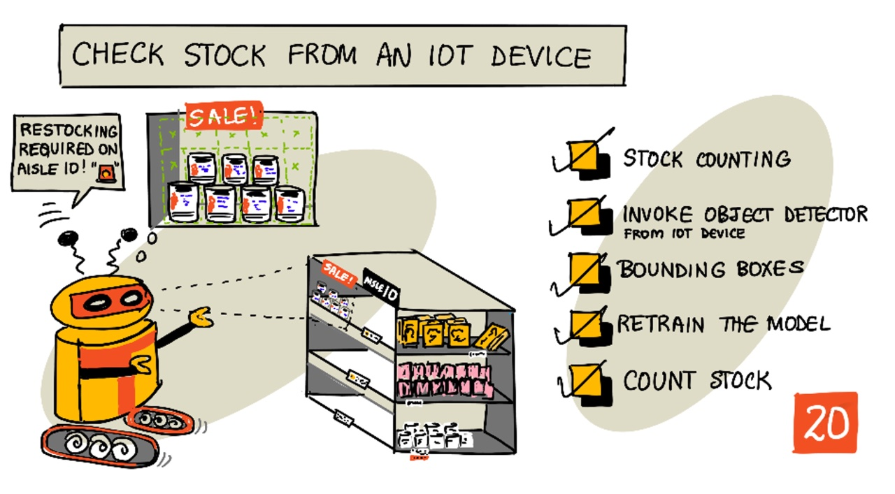
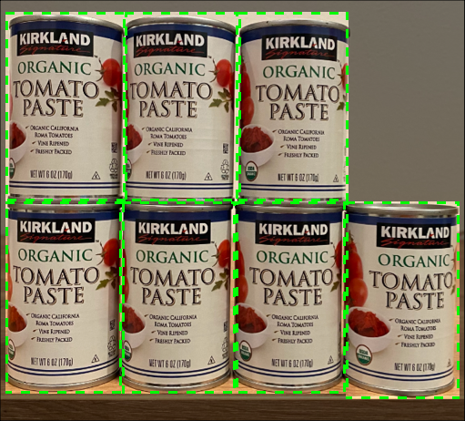
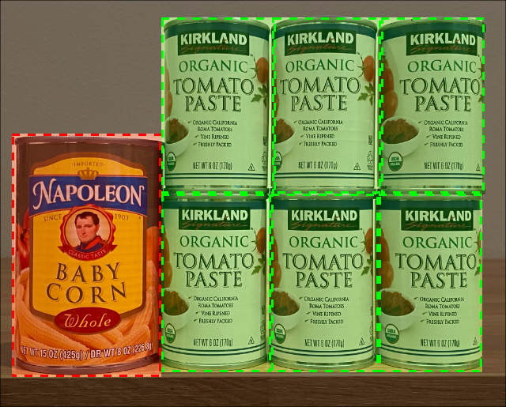
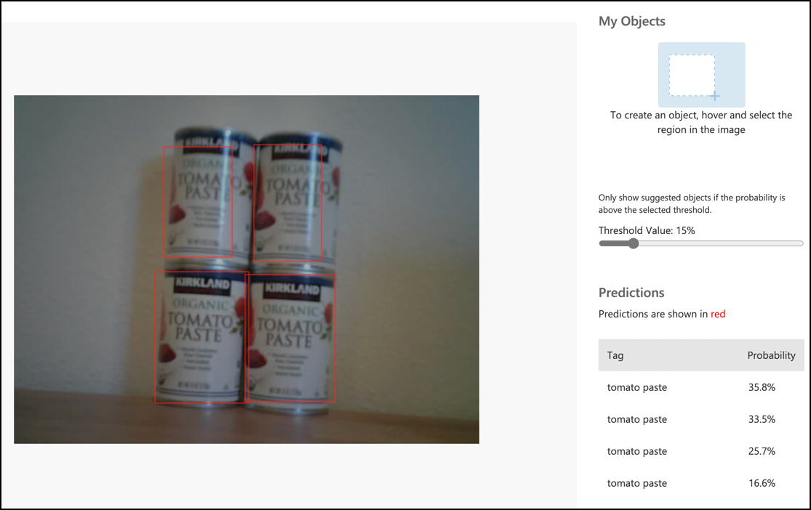
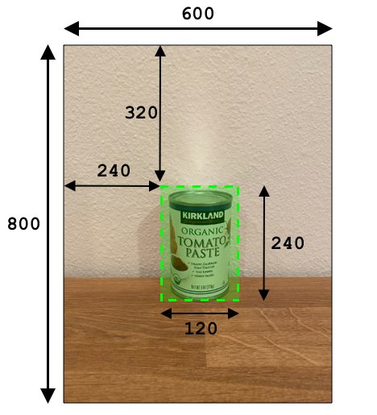
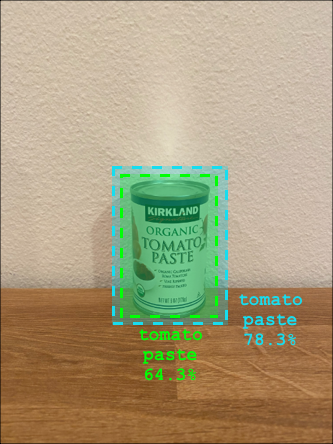

# Check stock from an IoT device

> Sketchnote by [Nitya Narasimhan](https://github.com/nitya). Click the image for a larger version.

## Introduction

In the previous lesson you learned about the different uses of object detection in retail. You also learned how to train an object detector to identify stock. In this lesson you will learn how to use your object detector from your IoT device to count stock.

In this lesson we'll cover:

* [Stock counting](#stock-counting)
* [Call your object detector from your IoT device](#call-your-object-detector-from-your-iot-device)
* [Bounding boxes](#bounding-boxes)
* [Count stock](#count-stock)

## Stock counting

Object detectors can be used for stock checking, either counting stock or ensuring stock is where it should be. IoT devices with cameras can be deployed all around the store to monitor stock, starting with hot spots where having items restocked is important, such as areas where small numbers of high value items are stocked.

For example, if a camera is pointing at a set of shelves that can hold 8 cans of tomato paste, and an object detector only detects 7 cans, then one is missing and needs to be restocked.

In the above image, an object detector has detected 7 cans of tomato paste on a shelf that can hold 8 cans. Not only can the IoT device send a notification of the need to restock, but it can even give an indication of the location of the missing item, important data if you are using robots to restock shelves.

> 💁 Depending on the store and popularity of the item, restocking probably wouldn't happen if only 1 can was missing. You would need to build an algorithm that determines when to restock based on your produce, customers and other criteria.

✅ In what other scenarios could you combine object detection and robots?

Sometimes the wrong stock can be on the shelves. This could be human error when restocking, or customers changing their mind on a purchase and putting an item back in the first available space. When this is a non-perishable item such as canned goods, this is an annoyance. If it is a perishable item such as frozen or chilled goods, this can mean that the product can no longer be sold as it might be impossible to tell how long the item was out of the freezer.

Object detection can be used to detect unexpected items, again alerting a human or robot to return the item as soon as it is detected.

In the above image, a can of baby corn has been put on the shelf next to the tomato paste. The object detector has detected this, allowing the IoT device to notify a human or robot to return the can to it's correct location.

## Call your object detector from your IoT device

The object detector you trained in the last lesson can be called from your IoT device.

### Task - get your object detector ready to be called

With Custom Vision you had to publish an iteration of your model. With Roboflow, once a model has finished training you can use it through a *workflow*, which is the service your IoT device will call.

1. Open your Roboflow workspace and select the trained model of your `stock-detector` project. Then open its **Deploy** panel. You will need three values to call it from your IoT device:

    - **API key** - from the settings of your workspace. It is a secure key that you have to pass when you call the workflow. Only applications that pass this key are allowed to use it, any other applications are rejected.
    - **Workspace name** - it appears in the URL, `app.roboflow.com/<workspace>/...`.
    - **Workflow ID** - shown in the *Deploy* panel.

    > ⚠️ Do not share your API key or publish it in a public repository.

✅ When you train a new version of your model, how do you think you would change the model your IoT device is using? Think about what has to change in the workflow, and what has to change in the code of your device.

### Task - call your object detector from your IoT device

Follow the relevant guide below to use the object detector from your IoT device:

* **[Microcontroller ESP32](esp32-object-detector.md) <<<<----------**

## Bounding boxes

When you use the object detector, you not only get back the detected objects with their classes and probabilities, but you also get the bounding boxes of the objects. These define where the object detector detected the object with the given probability.

> 💁 A bounding box is a box that defines the area that contains the object detected, a box that defines the boundary for the object.

When you test your model in Roboflow, the results have the bounding boxes drawn on the image that was sent for prediction.

In the image above, 4 cans of tomato paste were detected. In the results a box is overlaid for each object that was detected in the image, indicating the bounding box for the object.

✅ Open your model in Roboflow, test it with some images, and check out the bounding boxes.

Roboflow defines bounding boxes with 4 values, measured in **pixels**: the `x` and `y` position of the **center** of the box, and its `width` and `height`. The origin (the 0,0 position) is the top left of the image, so `x` is the distance from the left, and `y` is the distance from the top. The response also includes the size of the image that was analyzed.

The above image is 600 pixels wide and 800 pixels tall. The bounding box starts at 320 pixels down and 240 pixels across, is 120 pixels wide and 240 pixels tall. Its center is therefore at 240 + 120 / 2 = 300 pixels across and 320 + 240 / 2 = 440 pixels down.

| Value  | Pixels | Scale of 0-1 |
|--------|-------:|-------------:|
| x      | 300    | 0.5          |
| y      | 440    | 0.55         |
| width  | 120    | 0.2          |
| height | 240    | 0.3          |

Using values relative to the size of the image means that, no matter what size the image is scaled to, you can still work out where the box is.

You can use bounding boxes combined with probabilities to evaluate how accurate a detection is. For example, an object detector can detect multiple objects that overlap, for example detecting one can inside another. Your code could look at the bounding boxes, understand that this is impossible, and ignore any objects that have a significant overlap with other objects.

In the example above, one bounding box indicated a predicted can of tomato paste at 78.3%. A second bounding box is slightly smaller, and is inside the first bounding box with a probability of 64.3%. Your code can check the bounding boxes, see they overlap completely, and ignore the lower probability as there is no way one can be inside another.

✅ Can you think of a situation where is it valid to detect one object inside another?

## Count stock

Using a combination of the number of objects detected and the bounding boxes, you can count the stock on a shelf.

### Task - count stock

Follow the relevant guide below to count stock using the results from the object detector from your IoT device:

* **[Microcontroller ESP32](esp32-count-stock.md) <<<<----------**

---

## 🚀 Challenge

Can you detect incorrect stock? Train your model on multiple objects, then update your app to alert you if the wrong stock is detected.

Maybe even take this further and detect stock side by side on the same shelf, and see if something has been put in the wrong place by defining limits on the bounding boxes.

## Review & Self Study

* Learn more about how to architect an end-to-end stock detection system from the [Out of stock detection at the edge pattern guide on Microsoft Docs](https://docs.microsoft.com/hybrid/app-solutions/pattern-out-of-stock-at-edge?WT.mc_id=academic-17441-jabenn)
* Learn other ways to build end-to-end retail solutions combining a range of IoT and cloud services by watching this [Behind the scenes of a retail solution - Hands On! video on YouTube](https://www.youtube.com/watch?v=m3Pc300x2Mw).
* Read the [Roboflow documentation](https://docs.roboflow.com) about workflows and about running models on your own hardware with Roboflow Inference.